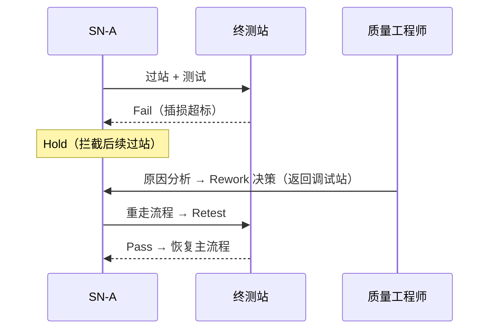
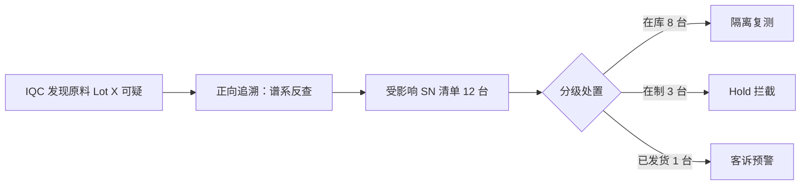

# 07.3 异常与质量案例

> 所属篇章：07_综合案例 ｜ 状态：⏳ 骨架（待填充）

## 本篇要回答的业务问题

- 单件异常（某 SN 测试失败）如何走完 Hold → Rework → Retest 闭环？
- 批量异常（某原料批次不良）如何通过正向追溯隔离受影响范围？
- SPC 越界如何触发停线决策？

## 案例 A：单件失败返工闭环

<!-- 待填充：叙事 + 状态流转 + 事件序列 -->

- 模型参照：[05.4_Hold_Rework_Retest_Scrap状态模型](../05_WhatActuallyHappened_实际发生了什么/05.4_Hold_Rework_Retest_Scrap状态模型.md)
- 检验点：处置期间该 SN 尝试过站应被拦截（`MES-4002`）

## 案例 B：批次原料异常 → 正向追溯 → 隔离

<!-- 待填充：叙事 -->

- 模型参照：[06.3_正向与反向追溯](../06_CanWeProveIt_能否证明/06.3_正向与反向追溯.md)、[06.2_Genealogy谱系模型](../06_CanWeProveIt_能否证明/06.2_Genealogy谱系模型.md)

## 案例 C：SPC 越界 → 停线决策

<!-- 待填充：叙事——连续参数趋势偏移 → SpcRule 告警（AlarmEvent New→Acknowledged）→ 质量决策停线 → 排查 → 恢复 -->

- 模型参照：[05.3_质量与异常业务模型](../05_WhatActuallyHappened_实际发生了什么/05.3_质量与异常业务模型.md)
- 实现参照：`SpcRule` / `AlarmEvent`（design.md §4.1、§5.3）

## 案例复盘模板

<!-- 待填充：每个案例的复盘维度——发现时效、数据完整性、处置留痕、可证明性 -->

## 关联文档

- 前置：[07.1_一个产品的一生](07.1_一个产品的一生.md)、[07.2_VOA产品生命周期业务建模](07.2_VOA产品生命周期业务建模.md)
