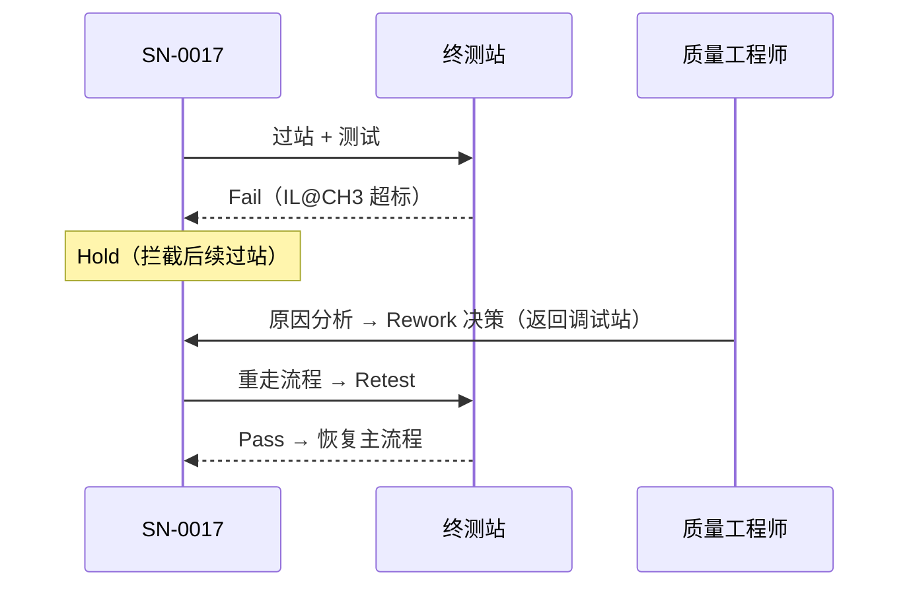
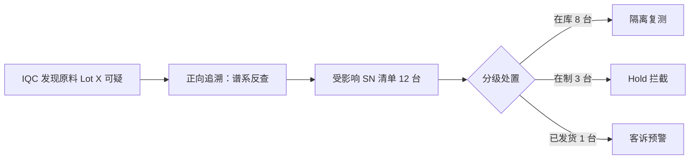

# 07.3 异常与质量案例

> 所属篇章：07_综合案例 ｜ 状态：✅ 已完成

## 本篇要回答的业务问题

- 单件异常（某 SN 测试失败）如何走完 Hold → Rework → Retest 闭环？
- 批量异常（某原料批次不良）如何通过正向追溯隔离受影响范围？
- SPC 越界如何触发停线决策？

## 案例 A：单件失败返工闭环

叙事（承接 [07.1 第 4 章](07.1_一个产品的一生.md) 的 `VOA261030-0017`）：

14:05 终测站，`VOA261030-0017` 上传结果：`IL@CH3 = 2.4dB` 超上限，判定 Fail。MES 写入 TestRecord（首次失败，永久保留），SN 状态 InProcess → TestedFail，**Hold 生效**。操作员尝试直接把它再过一次外观站——被 `MES-4002` 拦截（失败品未处置）。

14:30 质量工程师 QE-301 打开处置界面：失败详情（参数、原始报文、该件调试记录）+ 同批合格件的对照数据。分析结论：CH3 衰减器偏调（调试问题，非来料问题——谱系显示该位置芯片批次与良品一致）。决策：**Rework 返回调试站（步骤 20）**，审批人 QE-301、理由记录在案。

15:00 调试站重新校准 → 重走终测 → **新 TestBatchId**，复测 `IL@CH3 = 1.9dB`，Pass。SN 恢复 InProcess，继续主流程。

状态流转 + 事件序列：

- 模型参照：[05.4_Hold_Rework_Retest_Scrap状态模型](../05_WhatActuallyHappened_实际发生了什么/05.4_Hold_Rework_Retest_Scrap状态模型.md)
- **检验点：处置期间该 SN 尝试过站应被拦截（`MES-4002`）**——本案例 14:05–15:00 之间的拦截就是验收证据。这也对应 M1 验收标准「失败品未处置不流出」（`AGENTS.md` 不可弱化项）。
- 时间线复盘：该 SN 的追溯视图应包含——过站 ×5、首次 Fail 测试记录、处置事件（Rework 决策 + 审批人）、换料（无）、复测记录（新批次）——**两次测试记录并存**，FPY 统计取首次，最终良率取末次。

## 案例 B：批次原料异常 → 正向追溯 → 隔离

叙事：11 月 25 日，IQC 对在库物料例行复检时发现衰减芯片 `L-7712`（已部分投产）供应商自检报告异常，判定可疑。该批次已上线使用了多少？流入了哪些产品？

质量部执行正向追溯（6.2 §4 查询模板）：`genealogy_links WHERE child_ref = 'L-7712'` 递归到根 → **受影响 SN 清单 12 台**（假设值）。

处置执行：在制 3 台由系统**批量 Hold**（下次过站即拦截）；在库 8 台移入隔离区，安排复测（复测 Fail 的走 Rework 换料——新批次入谱系）；已发货 1 台通知销售与客户协商。NC 单开立，根因确认供应商批次一致性；CAPA：该供应商来料 IQC 加严 + 供应商 8D 报告要求。

- 模型参照：[06.3_正向与反向追溯](../06_CanWeProveIt_能否证明/06.3_正向与反向追溯.md)、[06.2_Genealogy谱系模型](../06_CanWeProveIt_能否证明/06.2_Genealogy谱系模型.md)
- **前置依赖声明**：本案例要求上料记录已落地（M1 现状无谱系——如用当前系统演练，此即断链所在；见 [06.1 §4](../06_CanWeProveIt_能否证明/06.1_Traceability业务模型.md) 完整性边界）。它同时说明**为什么「先记录」原则要求上料事实必须先于门控落地**。

## 案例 C：SPC 越界 → 停线决策

叙事：某周终测站 FT-01，SPC 引擎按小时聚合 `IL` 均值。周二 14:00 起，连续 3 个统计窗的均值逐窗上移，14:00 窗触发 `SpcRule`（IL 均值 > UCL）→ 生成 **AlarmEvent（New，级别：严重）**，推送看板与质量工程师。

14:02 QE 确认告警（Acknowledged），下钻：越界时段 FT-01 全部测试记录——均值漂移但个体多数未超规格限（「临界品」增多）。初步判断不是单点问题（不是个别 SN）而是**系统性漂移**。

14:15 排查三连：环境（温湿度曲线正常）→ 设备（FT-01 测试仪上周校准，有效）→ 治具（**14:00 恰有换型记录**：更换了新治具）。结论：新治具光路对准偏差导致插损整体偏高。

14:30 **质量决策：停线**——FT-01 暂停过站（工单级暂停，在制 SN 冻结），更换治具后重测校准品验证。15:00 恢复生产。

后续：14:00–14:30 时段生产的 22 台「临界品」全部正向圈出（时间窗 + 工站过滤，06.3 §3 第三类起点），加严复测；治具维护记录更新；AlarmEvent Resolved → Closed（处理人留痕）。

- 模型参照：[05.3_质量与异常业务模型](../05_WhatActuallyHappened_实际发生了什么/05.3_质量与异常业务模型.md)
- 实现参照：`SpcRule` / `AlarmEvent`（design.md §4.1、§5.3）
- 要点：**SPC 告警不停线，停线是人的决策**——系统的价值是把「发现 → 决策」从小时级压到分钟级（告警即达 + 一键下钻）；且停线影响的处置（临界品圈出）依然由追溯数据支撑。

## 案例复盘模板

每个案例的复盘维度（异常处置的「处置处置」）：

| 维度 | 追问 | 案例表现 |
| --- | --- | --- |
| 发现时效 | 从异常发生到被发现，多久？ | A：即时（Fail 即拦）；B：滞后（IQC 复检发现——上料时无拦截）；C：提前（SPC 在个体超差前预警） |
| 数据完整性 | 处置依据的数据齐全吗？ | A：测试 + 调试记录 + 谱系齐全；B：依赖谱系完整（前置声明）；C：SPC 时序 + 治具记录 |
| 处置留痕 | 决策人、理由、时间可查吗？ | 三案例均要求 DisposalEvent / 审批留痕 |
| 可证明性 | 事后审核能还原全程吗？ | 时间线 + 处置事件 + 审批 = 证据链完整 |
| 预防再发 | 有 CAPA 吗？ | B（IQC 加严 + 8D）、C（治具维护流程）；A 若为个体偶发则不需要 |

复盘的元原则：**异常案例是模型的试金石**——每个案例都在检验某个模型断点（A 验证状态机拦截、B 验证谱系、C 验证 SPC 与上下文记录）。跑不通的案例，就是下一步建设的优先级（对应 [08.4 方法论](../08_MES业务全景/08.4_MES业务建模方法论.md) 的完成度检查）。

## 关联文档

- 前置：[07.1_一个产品的一生](07.1_一个产品的一生.md)、[07.2_VOA产品生命周期业务建模](07.2_VOA产品生命周期业务建模.md)
