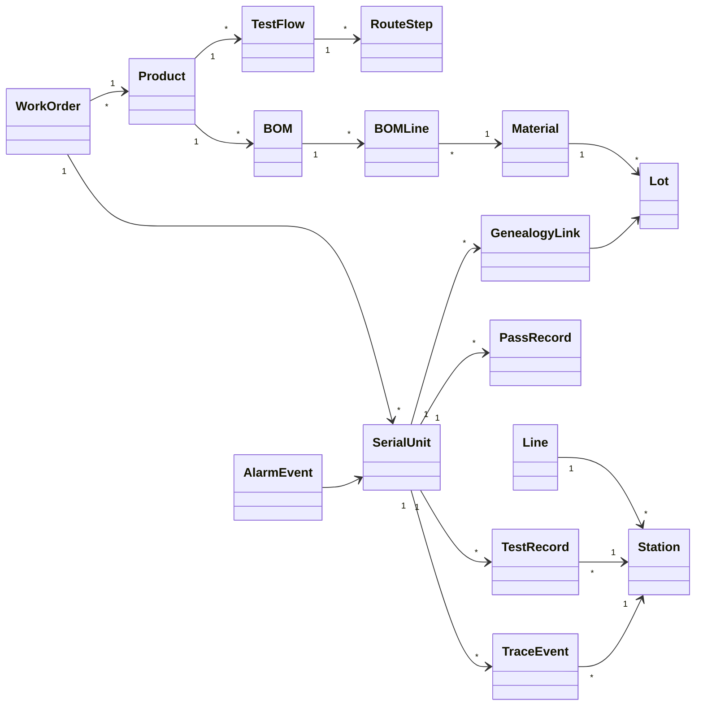
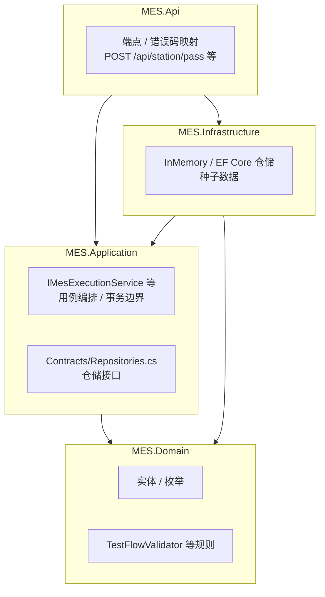

# 08.1 MES 核心 Domain Model

> 所属篇章：08_MES业务全景 ｜ 状态：✅ 已完成

## 本篇要回答的业务问题

- 把 00–07 的所有业务对象合成一张全局领域模型，关系全貌是什么？
- 聚合边界（Aggregate）如何划分？谁是聚合根？
- 领域模型与代码分层（Domain / Application / Infrastructure / Api）如何映射？

## 1. 全局领域模型类图

逐个聚合说明：

| 聚合 | 聚合根 | 聚合内成员 | 聚合外引用（按 ID） | 关键不变量 |
| --- | --- | --- | --- | --- |
| 工艺定义 | TestFlow | RouteStep | ProductCode、StationCode | 步骤序号唯一递增；同产品至多一个 active |
| 产品结构 | Product | ProductVersion、BOM、BOMLine | MaterialCode | BOM 随版本整体发布（00.3） |
| 物料 | Material | Lot | — | 关键料管控开关强制开启（01.2） |
| 工单 | WorkOrder | 数量、状态 | ProductCode、TestFlowCode | 数量对账不变量（02.1 §3） |
| 单件 | **SerialUnit** | 状态、步骤进度 | WorkOrderNo、CurrentStationCode | 状态机合法迁移封闭集（04.2） |
| 测试事实 | TestRecord | Metrics、RawPayload | Sn、StationCode | **幂等键 (sn, station_code, test_batch_id) 唯一** |
| 事件事实 | TraceEvent | 上下文快照 | Sn、StationCode、OperatorId | 只追加不修改（05.1） |
| 谱系 | GenealogyLink | — | ParentSn、ChildRef | 随上料事件同事务写入（06.2） |

跨聚合只按 ID 引用的含义：例如 `TestRecord` 不内嵌 `Station` 实体，只存 `StationCode` + 必要快照值——跨聚合对象引用走 ID，保证聚合间无加载级联、无双向耦合（也呼应 [03.4](../03_WhoWhereWithWhat_谁在哪里用什么生产/03.4_5M1E制造上下文模型.md) 的快照原则）。

## 2. 聚合划分（建议）

| 聚合根 | 聚合内成员 | 边界理由 |
| --- | --- | --- |
| WorkOrder | 数量、状态 | 计划一致性边界 |
| TestFlow | RouteStep | 流程定义整体生效（版本原子性） |
| SerialUnit | 过站记录引用、状态 | 单件生命周期一致性 |
| Station / Line | 设备引用 | 主数据 |
| Material / Lot | 批次 | 主数据 |

聚合划分的理由展开：

- **TestFlow 聚合 RouteStep**：流程版本的激活/失效必须**原子**——不允许「半个流程生效」。步骤脱离所属流程无业务意义。
- **SerialUnit 聚合状态与进度**：过站校验（顺序 + 状态 + 授权）是跨多个字段的联合判断，必须在一个事务边界内完成一致性（单 SN 的状态推进不与其他 SN 竞争——天然无并发热点）。
- **WorkOrder 聚合数量**：CompletedQty / ScrapQty / WIP 的对账不变量要求更新原子性。
- **事实类（TestRecord / TraceEvent / GenealogyLink）不设聚合根协作**：它们是**不可变追加**的记录（各自独立成行），幂等键归属 TestRecord 自己（唯一约束而非聚合协作），这也是「事实层」与「执行层」的本质区别——执行层靠聚合保护一致性，记录层靠唯一键与追加语义。

## 3. 与代码分层的映射

对照 `AGENTS.md` 分层依赖规则：

- **Domain**：聚合、状态机、校验规则（如失败品未处置不得过站）——`SerialUnit` + `SerialStatus`、`TestFlowValidator`。**业务规则的唯一权威落点**（`AGENTS.md`：Api 层不写业务逻辑）。
- **Application**：用例编排（`IMesExecutionService`：过站、上传、追溯；`ITestFlowService` / `IStationService` / `ISpcService`）——用例 = 聚合协作的脚本（如「过站」用例串联：校验 → 更新 SN → 写事件，同事务）。
- **Infrastructure**：仓储实现、外部集成（InMemory 现状 → EF Core / PostgreSQL、RabbitMQ、SignalR 计划）。
- **Api**：HTTP 映射与错误码（`MES-xxxx` → HTTP 状态 + CommandResult）。

依赖方向的意义：**Domain 不知道谁在调用它**——API 形态变化（REST → gRPC）、持久化替换（内存 → PostgreSQL）、消息中间件升级，都不触碰业务规则。模型稳定性由此转化为代码稳定性。

## 关联文档

- 分域明细：[01.3](../01_What_应该生产什么/01.3_产品定义UML类图.md)、[00.4_MES核心业务对象地图](../00_MES业务建模总纲/00.4_MES核心业务对象地图.md)
- 平行：[08.2_MES端到端业务活动图](08.2_MES端到端业务活动图.md)、[08.3_MES全局状态模型](08.3_MES全局状态模型.md)
- 实现参照：`AGENTS.md` 核心领域概念表、`design.md` §4
