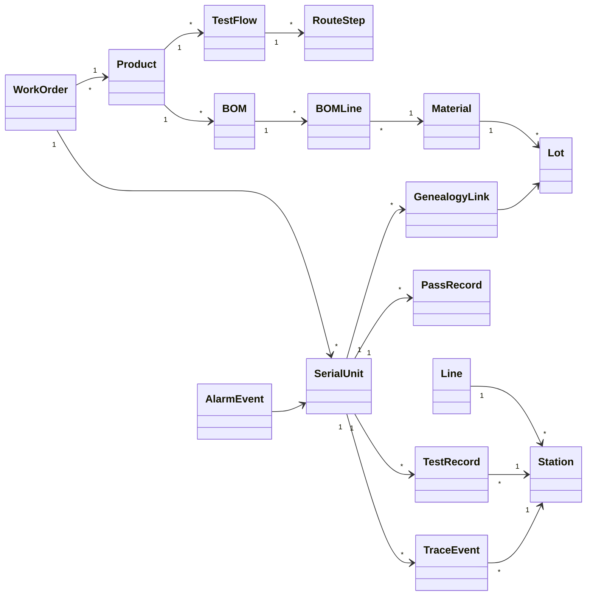

# 08.1 MES 核心 Domain Model

> 所属篇章：08_MES业务全景 ｜ 状态：⏳ 骨架（待填充）

## 本篇要回答的业务问题

- 把 00–07 的所有业务对象合成一张全局领域模型，关系全貌是什么？
- 聚合边界（Aggregate）如何划分？谁是聚合根？
- 领域模型与代码分层（Domain / Application / Infrastructure / Api）如何映射？

## 1. 全局领域模型类图

<!-- 待填充：逐个聚合说明；本图为骨架占位，需补齐属性与基数 -->

## 2. 聚合划分（建议）

| 聚合根 | 聚合内成员 | 边界理由 |
| --- | --- | --- |
| WorkOrder | 数量、状态 | 计划一致性边界 |
| TestFlow | RouteStep | 流程定义整体生效（版本原子性） |
| SerialUnit | 过站记录引用、状态 | 单件生命周期一致性 |
| Station / Line | 设备引用 | 主数据 |
| Material / Lot | 批次 | 主数据 |

<!-- 待填充：跨聚合只按 ID 引用；不变量归属（如幂等键归属 TestRecord） -->

## 3. 与代码分层的映射

<!-- 待填充：对照 AGENTS.md 分层依赖规则 -->

- Domain：聚合、状态机、校验规则（如失败品未处置不得过站）
- Application：用例编排（`IMesExecutionService`：过站、上传、追溯）
- Infrastructure：仓储实现、外部集成
- Api：HTTP 映射与错误码（`MES-xxxx`）

## 关联文档

- 分域明细：[01.3](../01_What_应该生产什么/01.3_产品定义UML类图.md)、[00.4_MES核心业务对象地图](../00_MES业务建模总纲/00.4_MES核心业务对象地图.md)
- 平行：[08.2_MES端到端业务活动图](08.2_MES端到端业务活动图.md)、[08.3_MES全局状态模型](08.3_MES全局状态模型.md)
- 实现参照：`AGENTS.md` 核心领域概念表、`design.md` §4
