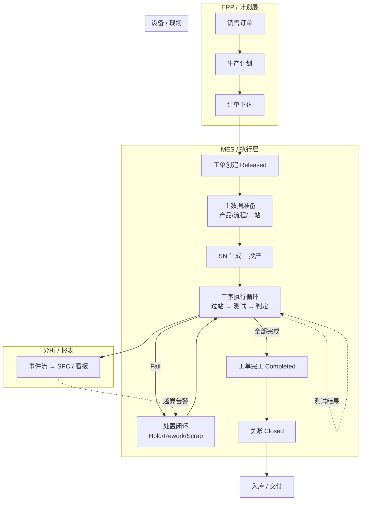

# 08.2 MES 端到端业务活动图

> 所属篇章：08_MES业务全景 ｜ 状态：✅ 已完成

## 本篇要回答的业务问题

- 从 ERP 订单到入库交付，MES 与周边系统的端到端全景流程是什么？
- 各环节的责任系统（ERP / MES / 设备 / 人员）如何划分（泳道）？
- 主干与异常分支在全景中如何共存？

## 1. 端到端活动图（泳道）



逐环节标注里程碑（对照 `design.md` §11）：

| 环节 | M1 执行闭环 | M2 约束 + SPC | M3 追溯 + 看板 |
| --- | --- | --- | --- |
| 订单下达（ERP → MES） | 手工创建工单（预留接口） | — | — |
| 主数据准备 | ✅ 工站 / TestFlow 管理 + 激活 | 流程版本治理、审计 | — |
| SN 生成 + 投产 | ✅ 过站时生成 | — | — |
| 工序执行循环 | ✅ 过站门控 + 测试上传（幂等） | 处置闭环（审批）、防跳站强化 | 时间线完善 |
| 处置闭环 | ⏳ 部分（Fail 拦截已有；审批处置未落地） | ✅ Hold/Rework/Scrap 工作流 | — |
| 事件流 → SPC / 看板 | — | ✅ SPC 汇总 + 告警 | ✅ SignalR 实时看板 + 报表 |
| 工单完工 / 关账 | ⏳ 状态枚举已就位 | 数量对账校验 | — |
| 入库 / 交付 | ❌ 边界外 | — | — |

图中的两条反馈边是全景的关键：

1. **H → G（处置回到执行）**：异常处理后产品回到主循环——闭环而非旁路；
2. **K → H（告警触发处置）**：分析层不直接干预执行（SPC 不停线，人停线——05.3 §5），但通过告警驱动处置动作。

## 2. 系统边界与接口

对照 `design.md` §2 范围：

| 邻居 | 交互 | 第一阶段策略 |
| --- | --- | --- |
| 上游：ERP | 订单 / 主数据下达；MES 绩效回报 | **仅预留接口，不做双向业务闭环**（§2.2 明确不做） |
| 下游：设备 / 上位机 | 测试任务下发意图（由 MES 门控表达）；结果上传 | 首期 HTTP/REST（幂等 + 补传）；OPC-UA / TCP 第二阶段 Device Gateway |
| 平行：WMS | 入库 / 出库 / 库存 | ❌ 明确不做（追溯终点声明为 Done） |
| 平行：APS | 排产 | ❌ 明确不做（`AGENTS.md`：不做大而全 MES） |

边界纪律的价值：每个「不做」都在保护 M1 执行闭环的交付时间——范围冻结 + Out of Scope 清单是反「需求蔓延」的制度武器（`从MIMS到MES` §12：做成大而全 = 风险）。

## 3. 关键闭环检查

执行闭环（工单 → 过站 → 上传 → 追溯）的断点排查思路——按数据流逐段验证：

```text
[工单] --创建成功？--> [SN/过站] --事件落库？--> [测试] --记录落库？--> [追溯] --可查询？--> [报表]
```

| 检查点 | 验证方法 | 断点症状 |
| --- | --- | --- |
| 工单创建 | 重复创建返回 `MES-4091` | 工单可重复 = 幂等失效 |
| 过站门控 | 构造跳站请求，应拦 `MES-4002` | 能跳站 = 顺序校验失效 |
| 先过站后测试 | 未过站直接上传，应拦 `MES-4002` | 能上传 = 前置校验失效 |
| 失败拦截 | Fail 后过站，应拦 `MES-4002` | 能流出 = 底线约束失效（最严重） |
| 上传幂等 | 同三元组重发，应返 `MES-4091` | 重复计数 = 幂等失效 |
| 事务一致性 | 测试写入后查 SN 状态与事件 | 三者不一致 = 事务边界缺失 |
| 追溯完整 | 随机抽 SN，对 06.1 清单逐问核对 | 答不上 = 对应断链 |
| 断网补传 | 拔网线测完再补传 | 补传丢数或乱序 = 设备不稳定假设未兜住 |

这些检查即 `tests/MES.Domain.Tests` 的优先覆盖项（`AGENTS.md` Testing Instructions：幂等去重、SN 状态流转、工序顺序校验、测试站 PASS 门控），也是现场验收（M1：单条产线稳定完成从过站到测试入库）的演练脚本。

## 关联文档

- 单产品视角：[02.3_产品制造流程UML活动图](../02_WhatToDo_应该执行什么/02.3_产品制造流程UML活动图.md)
- 案例串联：[07.1_一个产品的一生](../07_综合案例/07.1_一个产品的一生.md)
- 实现参照：`design.md` §3 总体架构、§11 里程碑
