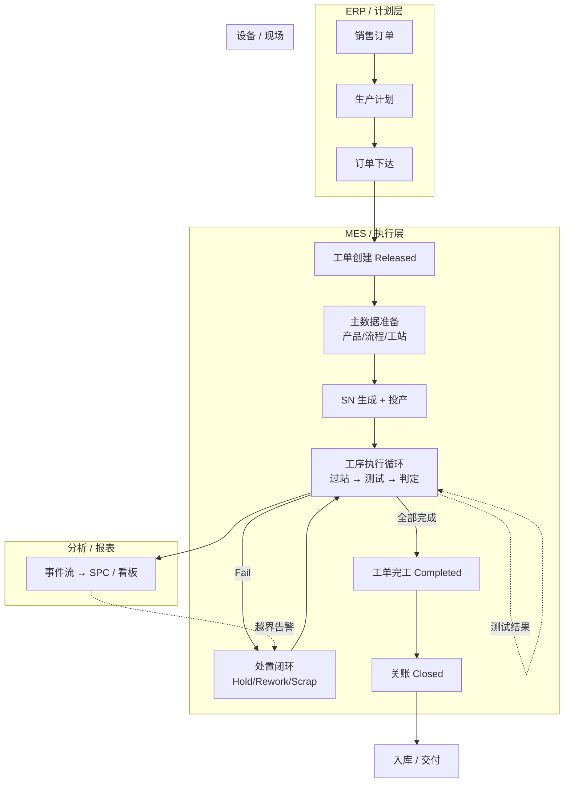

# 08.2 MES 端到端业务活动图

> 所属篇章：08_MES业务全景 ｜ 状态：⏳ 骨架（待填充）

## 本篇要回答的业务问题

- 从 ERP 订单到入库交付，MES 与周边系统的端到端全景流程是什么？
- 各环节的责任系统（ERP / MES / 设备 / 人员）如何划分（泳道）？
- 主干与异常分支在全景中如何共存？

## 1. 端到端活动图（泳道）

<!-- 待填充：逐环节标注 M1 已实现 / M2 / M3 计划（对照 design.md §11 里程碑） -->

## 2. 系统边界与接口

<!-- 待填充：对照 design.md §2 范围 -->

- 上游：ERP（第一阶段仅预留接口，不做双向闭环）
- 下游：设备 / 上位机（HTTP/REST 首期；OPC-UA/TCP 第二阶段）
- 平行：WMS、APS（明确不做，第一阶段）

## 3. 关键闭环检查

<!-- 待填充：执行闭环（工单→过站→上传→追溯）的断点排查思路 -->

## 关联文档

- 单产品视角：[02.3_产品制造流程UML活动图](../02_WhatToDo_应该执行什么/02.3_产品制造流程UML活动图.md)
- 案例串联：[07.1_一个产品的一生](../07_综合案例/07.1_一个产品的一生.md)
- 实现参照：`design.md` §3 总体架构、§11 里程碑
