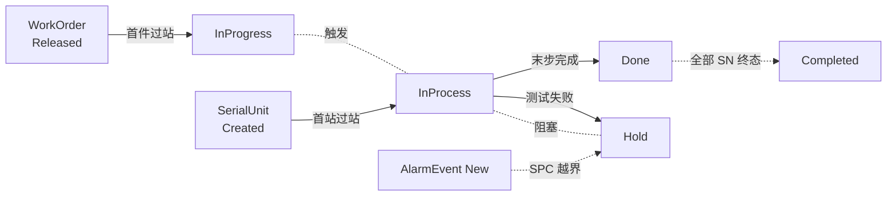

# 08.3 MES 全局状态模型

> 所属篇章：08_MES业务全景 ｜ 状态：⏳ 骨架（待填充）

## 本篇要回答的业务问题

- WorkOrder / SerialUnit / Operation / AlarmEvent 多个状态机如何协同？
- 状态同步规则是什么？（如：工单完工条件与 SN 终态的关系）
- 有哪些全局状态不变量，违反即 Bug？

## 1. 状态机清单（汇总）

| 状态机 | 所在篇目 | 状态集 |
| --- | --- | --- |
| WorkOrder | [02.1](../02_WhatToDo_应该执行什么/02.1_生产订单模型.md) | Created → Released → InProgress → Paused → Completed → Closed |
| SerialUnit | [04.2](../04_WhatIsHappening_现在正在发生什么/04.2_SN生命周期状态机.md) | Created → InProcess → TestedPass / TestedFail → Rework / Scrapped → Done |
| Operation | [04.3](../04_WhatIsHappening_现在正在发生什么/04.3_Operation执行状态机.md) | Queued → Ready → MoveIn → InWork → WaitForTest → Tested → MoveOut |
| 处置 Disposal | [05.4](../05_WhatActuallyHappened_实际发生了什么/05.4_Hold_Rework_Retest_Scrap状态模型.md) | Hold → Release / Rework / Retest / Scrap |
| AlarmEvent | [05.3](../05_WhatActuallyHappened_实际发生了什么/05.3_质量与异常业务模型.md) | New → Acknowledged → Resolved → Closed |
| TestFlow | [02.2](../02_WhatToDo_应该执行什么/02.2_Routing与Operation模型.md) | Draft → Active → Inactive |

## 2. 状态协同图

<!-- 待填充：协同规则的完整清单与优先级（状态冲突时谁服从谁） -->

## 3. 全局不变量

<!-- 待填充：以下为初始清单 -->

- 失败品未处置（Hold 未闭环）不得过站（`MES-4002`）
- 测试结果上传前必须存在同工站过站记录
- TestRecord 以 `(sn, station_code, test_batch_id)` 唯一（`MES-4091`）
- 工单 Completed 前提：全部 SN 到达终态（Done / Scrapped）
- 同一产品同一时刻至多一个 Active 测试流程（`MES-4004`）

## 4. 状态一致性实现策略

<!-- 待填充：状态变更与事件写入的事务边界（Application 层）；并发冲突处理（同一 SN 同时过站） -->

## 关联文档

- 平行：[08.1_MES核心Domain_Model](08.1_MES核心Domain_Model.md)、[08.2_MES端到端业务活动图](08.2_MES端到端业务活动图.md)
- 实现参照：`design.md` §4.2 关键状态机
