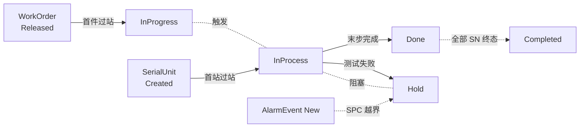

# 08.3 MES 全局状态模型

> 所属篇章：08_MES业务全景 ｜ 状态：✅ 已完成

## 本篇要回答的业务问题

- WorkOrder / SerialUnit / Operation / AlarmEvent 多个状态机如何协同？
- 状态同步规则是什么？（如：工单完工条件与 SN 终态的关系）
- 有哪些全局状态不变量，违反即 Bug？

## 1. 状态机清单（汇总）

| 状态机 | 所在篇目 | 状态集 |
| --- | --- | --- |
| WorkOrder | [02.1](../02_WhatToDo_应该执行什么/02.1_生产订单模型.md) | Created → Released → InProgress → Paused → Completed → Closed |
| SerialUnit | [04.2](../04_WhatIsHappening_现在正在发生什么/04.2_SN生命周期状态机.md) | Created → InProcess → TestedPass / TestedFail → Rework / Scrapped → Done |
| Operation | [04.3](../04_WhatIsHappening_现在正在发生什么/04.3_Operation执行状态机.md) | Queued → Ready → MoveIn → InWork → WaitForTest → Tested → MoveOut |
| 处置 Disposal | [05.4](../05_WhatActuallyHappened_实际发生了什么/05.4_Hold_Rework_Retest_Scrap状态模型.md) | Hold → Release / Rework / Retest / Scrap |
| AlarmEvent | [05.3](../05_WhatActuallyHappened_实际发生了什么/05.3_质量与异常业务模型.md) | New → Acknowledged → Resolved → Closed |
| TestFlow | [02.2](../02_WhatToDo_应该执行什么/02.2_Routing与Operation模型.md) | Draft → Active → Inactive |

注意 TestFlow 是**主数据生命周期**（定义层），其余五个是**运行时生命周期**（执行/记录层）——主数据状态机约束「谁可被引用」，运行时状态机约束「谁在发生」。两类状态机不直接联动，只通过引用校验交互（如：SN 过站时查流程必须是 Active）。

## 2. 状态协同图

协同规则的完整清单（状态冲突时谁服从谁）：

| # | 规则 | 方向 | 优先级说明 |
| --- | --- | --- | --- |
| R1 | 首件过站 → 工单 InProgress | SN → WO（上行） | 自动推进，无需审批 |
| R2 | Fail → SN Hold → **冻结该 SN 一切过站** | Operation → SN（上行） | **最高优先**：与任何其他规则冲突时，拦截获胜 |
| R3 | 全部 SN 终态 → 工单 Completed | SN → WO（上行） | 聚合判定（数量口径见 02.1 §2） |
| R4 | 末步 MoveOut（Pass）→ SN Done | Operation → SN（上行） | 与 R3 连锁 |
| R5 | 工单 Paused（全面冻结语义）→ 冻结在制 SN 过站 | WO → SN（下行） | 管理决策覆盖执行（M1 未实现，规则预留） |
| R6 | 报废审批 → SN Scrapped（终态） | 处置 → SN | 终态不可逆；触发 R3 评估 |
| R7 | SPC 告警 **不直接改任何执行状态** | 分析 → 人 → 处置 | 分析层无写权限（05.3 §5；07.3 案例 C） |
| R8 | 流程 Active ↔ SN 过站校验 | 主数据 → 运行时（引用） | 过站时校验当前绑定流程版本可解析 |

冲突裁决原则总结为一句：**安全约束（R2）> 管理冻结（R5）> 自动推进（R1/R3/R4）> 分析建议（R7，无强制力）**。R7 是刻意设计——让数据层建议、让人类决策，避免算法失控停线。

## 3. 全局不变量

**违反即 Bug**（违反任一条，系统数据不可信，须告警并人工介入）：

| # | 不变量 | 违反检测方法 |
| --- | --- | --- |
| INV-1 | 失败品未处置（Hold 未闭环）不得过站（`MES-4002`） | 构造测试：Fail 后任意过站必须被拦截 |
| INV-2 | 测试结果上传前必须存在同工站过站记录 | 构造测试：未过站上传必须被拦截 |
| INV-3 | TestRecord 以 `(sn, station_code, test_batch_id)` 唯一（`MES-4091`） | 同键重复写入必须被拒（唯一索引兜底） |
| INV-4 | 工单 Completed 前提：全部 SN 到达终态（Done / Scrapped） | 完成时核对 SN 终态集合 |
| INV-5 | 同一产品同一时刻至多一个 Active 测试流程（`MES-4004`） | activate 后查询产品流程表 |
| INV-6 | 任意 SN 的当前状态 = 其事件流按状态机重放的结果 | 对账任务：定时重放比对（04.2 §2 推论） |
| INV-7 | 终态（Done / Scrapped）记录不可变更，只可追加新事件 | 代码审查 + 审计（无 UPDATE 通道） |
| INV-8 | 每次状态迁移伴随至少一条事件（无事件的状态变化不存在） | 对账任务：状态迁移数 = 事件数 |

INV-1/INV-2/INV-3 正是 M1 的三条验收底线（重复上传不重复计数、非法跳站被拦截、失败品不流出）；INV-6/INV-8 是运行期对账任务（M2+ 的数据完整性守护）。

## 4. 状态一致性实现策略

- **事务边界（Application 层）**：状态变更与事件写入**同事务**——「写 TestRecord + 更新 SerialUnit + 写 TraceEvent」要么全部成功要么全部回滚（`从MIMS到MES` §6.2 数据可信三件套之「事务」）。当前内存实现中由 `MesExecutionService` 的用例顺序保证；EF Core 落地后显式事务包裹。
- **并发冲突处理（同一 SN 同时过站）**：同一 SN 被两个工站同时扫码（少见但真实——扫码枪双击、网络重放）。策略：
  1. 聚合内串行化——以 SN 为锁粒度（乐观锁版本号或数据库行锁），同 SN 的状态迁移排队；
  2. 第二次请求重读状态后重试或返回明确错误（「该 SN 已在 XX 站过站」），而非静默覆盖；
  3. 幂等兜底：相同请求（同工站、同上下文）的重复提交返回成功（幂等语义）或 `MES-4091`（按业务键）。
- 消息发布（M2 RabbitMQ）放在**事务提交后**（Transactional Outbox 模式）——避免「库没提交、消息已发」或反之的幻象事件。

## 关联文档

- 平行：[08.1_MES核心Domain_Model](08.1_MES核心Domain_Model.md)、[08.2_MES端到端业务活动图](08.2_MES端到端业务活动图.md)
- 实现参照：`design.md` §4.2 关键状态机
