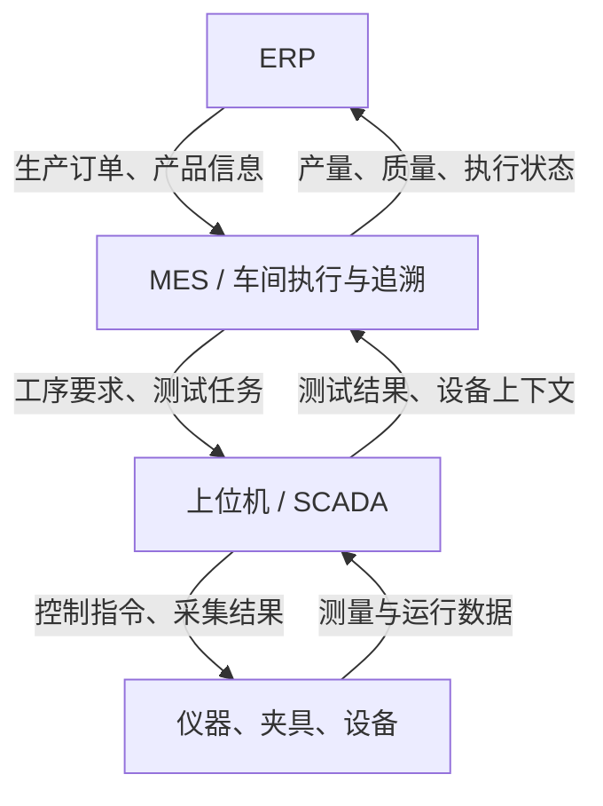
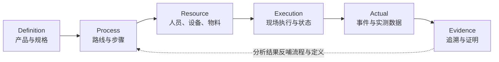
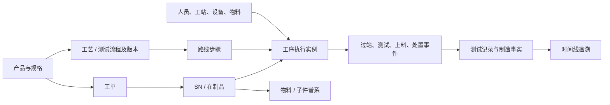
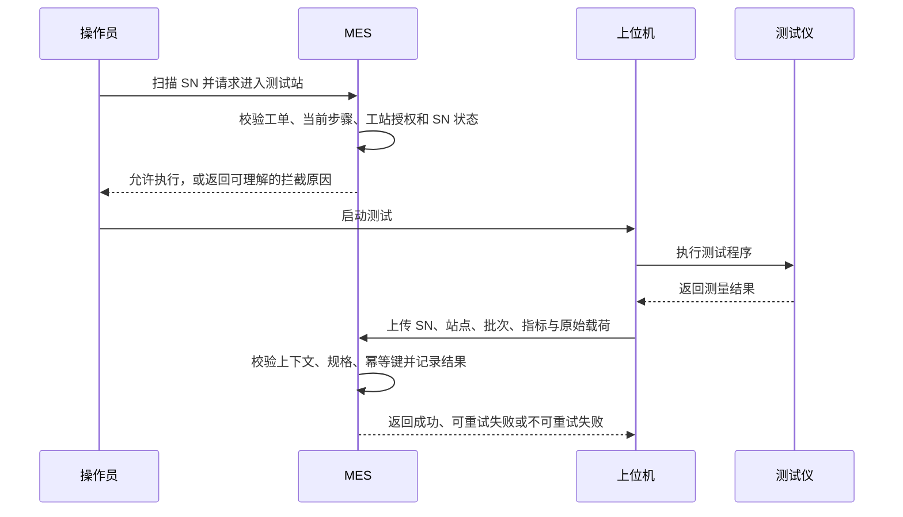
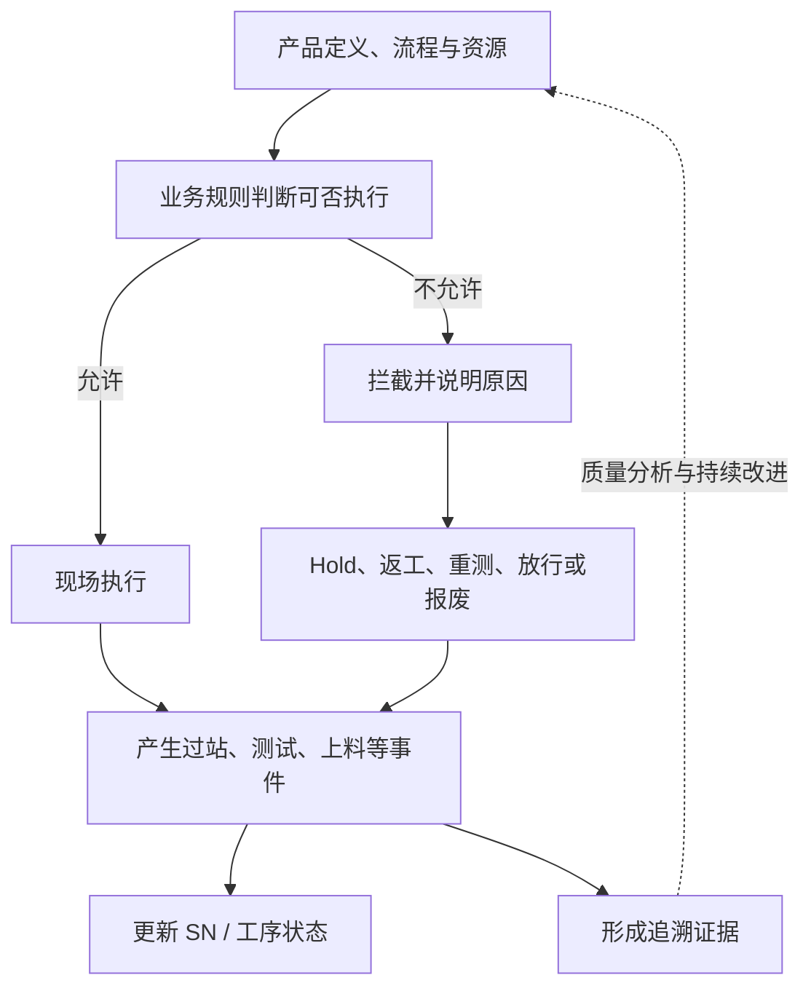

# MES系统概览学习

### 5W2H

读完本文，你应该能够：

- 用一句话说明 MES 的职责，以及它和 ERP、设备系统的分工。
- 用 5W2H 提出制造现场需要回答的问题。
- 用 5M1E 描述一次制造活动发生时的上下文。
- 理解 Definition、Process、Resource、Execution、Actual、Evidence 六个核心概念如何组成闭环。
- 从一个 SN 的旅程理解过站、测试、异常处置和追溯之间的联系。

## 先记住一句话

> **MES 把生产计划转化为现场可执行的流程，把现场实际发生的事记录下来，并在需要时用可信数据说明产品是怎样制造出来的。**

可以先把制造信息分成三类：

| 类别 | 核心问题 | 例子 |
| --- | --- | --- |
| 应该发生什么 | 产品、路线和规格是什么？ | 产品版本、工艺路线、测试限值 |
| 正在发生什么 | 这件产品现在在哪里、能做什么？ | 当前工序、待测状态、是否被 Hold |
| 实际发生了什么 | 现场刚才做了什么？结果如何？ | 过站记录、测试数据、返工记录 |

MES 的价值在于把这三类信息连起来：既能指导现场，也能保留实际事实，还能支持质量分析和追溯。

## 1. MES 在制造系统中的位置

制造现场通常由不同层级的系统各司其职：

| 系统 | 主要负责 | 不应混淆成什么 |
| --- | --- | --- |
| ERP | 企业级订单、计划和经营管理 | 不负责每个 SN 在工位上的实时执行细节 |
| MES | 车间订单执行、流程控制、生产事实与追溯 | 不等同于排产系统，也不只是报表系统 |
| 上位机 / SCADA | 设备或测试仪控制、现场数据采集 | 通常不负责跨工序的完整产品履历 |
| 设备 / 仪器 | 实际加工、测试或测量 | 不一定知道企业订单和产品全流程 |

在 ISA-95 的简化视角下，ERP 通常位于 L4，MES 位于 L3，SCADA / 上位机接近 L2，设备与控制器位于更靠近现场的层级。实际系统边界会因工厂而异，关键是明确每类信息由谁产生、谁负责、谁能修正。

## 2. 用 5W2H 看 MES 要解决的问题

5W2H 是一组提问工具，不是 MES 模块清单。讨论任何产线流程，都可以先从这七个问题开始。

| 问题 | 制造现场要问什么 | MES 常见关注点 |
| --- | --- | --- |
| **What：生产什么？** | 产品型号、版本、数量和质量要求是什么？ | 产品定义、工单、规格、物料要求 |
| **Why：为什么生产？** | 需求来自哪个订单？为什么需要这批产品？ | 订单来源、生产目的、变更依据 |
| **Who：谁来生产？** | 谁操作、谁检验、谁有权放行？ | 人员身份、技能资质、角色权限、审批责任 |
| **When：何时生产？** | 何时开工、测试、暂停、完工？时间是否可信？ | 事件时间、记录时间、班次、生产节拍 |
| **Where：在哪里生产？** | 哪个工厂、产线、工位或设备？ | 组织与位置层级、工站、设备绑定 |
| **How：如何生产？** | 按什么工艺、配方、程序和检查方法执行？ | 工艺路线、测试流程、Recipe、程序与版本 |
| **How much：生产多少、表现如何？** | 计划与实际数量是多少？质量、效率和成本怎样？ | 产量、良率、一次通过率、节拍、报废与返工 |

提问时要分清“计划值”和“实际值”。例如，工单计划生产 100 件是计划；最终完成 96 件、报废 2 件、还有 2 件在制，才是实际。两者不能用同一个字段或口径代替。

## 3. 用六个核心词理解 MES

这六个词从“事前定义”一路走到“事后证明”。

| 核心词 | 中文 | 直白解释 | 制造场景中的问题 |
| --- | --- | --- | --- |
| **Definition** | 定义 | 产品应该是什么样 | 生产哪个型号、版本？有哪些物料和规格？ |
| **Process** | 过程 | 产品应该经过什么步骤 | 先组装、再校准、再测试，还是有其他路线？ |
| **Resource** | 资源 | 由谁、在哪里、用什么执行 | 操作员是否有资质？设备和夹具是否适用？ |
| **Execution** | 执行 | 现场此刻正在发生什么 | SN 当前在哪站？是否允许开始或流转？ |
| **Actual** | 事实 | 现场实际发生了什么 | 实际用了哪个批次？测得什么数值？是否返工？ |
| **Evidence** | 证据 | 能否可信地还原并证明事实 | 谁在何时、用什么版本、依据什么结果放行？ |

它们可以连成一条主线：

### 六个核心词背后的业务对象

核心词是理解业务的入口，对象则是系统中承载这些业务概念的模型。不同工厂的命名会不同，但职责通常可以对应起来：

| 所属层次 | 常见对象 | 主要职责 | 例子 |
| --- | --- | --- | --- |
| Definition | Product、ProductVersion、BOM、Specification | 定义产品身份、组成和质量要求 | 某型号的产品版本、允许使用的物料和测试范围 |
| Process | Routing、Operation、TestFlow、RouteStep | 定义产品经过哪些步骤及步骤顺序 | 组装 → 校准 → 测试 → 包装 |
| Resource | Factory、Line、Station、Person、Equipment、Tool | 定义执行生产的组织、地点和资源 | 某条产线的终测工站和测试仪 |
| Execution | WorkOrder、SerialUnit、OperationInstance | 承载生产任务、单件在制状态和单次工序执行 | 某工单下的一个 SN 当前等待终测 |
| Actual | ManufacturingEvent、PassRecord、TestRecord、DisposalEvent | 记录已经发生的操作、测量和处置 | 某 SN 的测试失败、随后返工并重测 |
| Evidence | Traceability、Genealogy、AuditRecord | 汇总证明过程、产品组成和责任的信息 | 从成品追到物料批次和审批人 |

它们之间的典型关系可以这样理解：

有两点需要特别留意：

- **工艺步骤定义不等于工序执行记录。** RouteStep 描述“应该执行哪一步”；某个 SN 在该步骤的实际执行，应能单独说明进入时间、完成时间、使用资源、结果和异常。
- **BOM 不等于物料谱系。** BOM 描述“应该使用什么”；谱系描述“这件成品实际上用了什么”。只有记录上料或装配时的批次 / 子件关系，才能支持实际批次追溯。

### 一个关键区分：计划、状态、事实

- **计划**描述应该做什么，例如某产品应按已发布的流程版本经过终测。
- **状态**描述当前进度，例如 SN 已进入终测站，等待测试结果。
- **事实**描述已经发生的行为，例如某设备在某时刻上传了某批次测试结果。

状态是“现在的摘要”，事件和记录是“发生过的事情”。状态可以随着生产推进而变化；原始制造事实通常不应被静默覆盖。发现错误时，应保留原记录并追加纠正或处置记录。

## 4. 用 5M1E 描述一次制造活动

5M1E 是质量与制造领域常用的现场分析框架，用来检查一次生产或测试行为的上下文是否完整。

| 维度 | 英文 | 需要回答的问题 | 示例数据 |
| --- | --- | --- | --- |
| 人 | Man | 谁执行、谁复核？ | 操作员、检验员、审批人、班组 |
| 机 | Machine | 使用了什么设备或工具？ | 测试仪、设备编号、夹具、校准状态 |
| 料 | Material | 使用了什么物料？ | 物料编码、供应批次、子件 SN、用量 |
| 法 | Method | 按什么方法执行？ | 工艺步骤、Recipe、测试程序、版本 |
| 测 | Measurement | 测量了什么，依据什么判定？ | 参数、实测值、单位、规格版本、结果 |
| 环 | Environment | 当时的环境条件如何？ | 温度、湿度、时间、采集来源 |

不是每个工位都需要采集全部六类信息。例如，纯人工外观检验可能没有测试仪器；但对于关键测试站，设备、程序版本、规格版本和测试结果通常都很重要。采集范围应由追溯和质量风险决定，而不是为了“字段齐全”而无差别增加表单。

### 快照为什么重要？

如果追溯记录只保存“设备 ID”，而设备档案后来被修改，历史记录可能显示成当前信息。对于关键证据，系统需要保存当时使用的版本或必要的值快照，例如设备编号、程序版本、规格版本、操作员身份和事件时间。

还要区分两个时间：

- **发生时间**：现场行为实际发生的时间。
- **接收 / 记录时间**：MES 收到并保存数据的时间。

设备离线补传时，两者可能相差较大。保留这两个时间，才能正确还原现场顺序并识别延迟数据。

## 5. 跟着一个 SN 走完制造旅程

下面以一个光通信产品 SN 为例。它是用于理解业务的简化案例，不代表每条产线都采用相同工艺。

| 阶段 | 现场发生什么 | MES 需要知道什么 |
| --- | --- | --- |
| 1. 投产 | 工单下达，产品开始生产 | 产品型号、计划数量、工单状态、适用流程版本 |
| 2. 建立身份 | 为单件产品建立 SN | SN 属于哪个工单、产品版本是什么 |
| 3. 组装与上料 | 操作员装配部件，使用特定物料批次 | 操作员、工位、物料批次、子件 SN、装配时间 |
| 4. 调试或校准 | 使用设备和配方调整产品 | 设备、夹具、Recipe / 软件版本、执行结果 |
| 5. 测试 | 测试仪产生参数与原始结果 | SN、测试站、测试批次、参数值、单位、规格版本、原始报文 |
| 6. 发生异常 | 测试失败，产品被暂时拦截 | 失败事实、异常代码、Hold 状态、责任人和处置理由 |
| 7. 返工与重测 | 返工后再次测试 | 返工路线、每次测试记录、审批与最终判定；不能覆盖首次失败 |
| 8. 完工与追溯 | 产品完成制造，之后可能发生客诉 | 完整时间线、物料谱系、实际路径和最终去向 |

这段旅程揭示了一个重要原则：**测试 Pass 并不只是一个数值，它必须能回答“测的是哪件产品、依据哪一版规格、由什么设备和程序测得、失败后做了什么”。**

### 测试数据的两条腿

| 数据 | 用途 | 例子 |
| --- | --- | --- |
| 结构化指标 | 查询、判定、统计和 SPC | 参数名、实测值、单位、Pass / Fail |
| 原始载荷 | 复核设备原始输出、排查解析问题 | 上位机原始报文或原始文件引用 |

两者应能相互关联。结构化指标便于使用，原始数据便于复核；只保留其中一类，都会限制后续分析或问题调查。

### 一次测试从扫码到结果落库的完整闭环

把一次测试拆开看，可以发现它不只是“设备上传一组数值”：

每一步的责任要清楚：

1. **进入工站前校验。** MES 确认 SN 属于有效工单、当前路线允许该工站、前置步骤已完成，且 SN 没有处于未处置的 Hold 状态。
2. **测试设备执行。** 上位机或测试仪负责设备控制和原始测量；MES 不应假装自己控制了设备没有提供的能力。
3. **上传请求携带业务身份。** 至少需要能关联 SN、工站、测试批次、发生时间和指标；设备、测试程序、流程及规格版本应按追溯需求一并提供或从可信上下文解析。
4. **服务端验证并去重。** MES 校验请求是否符合当前业务上下文，并识别重复提交，避免网络重试导致重复计数。
5. **保存结果并更新执行状态。** 测试记录、制造事件和 SN / 工序状态之间应保持一致。采用数据库时，通常需要明确这些写入的事务边界。
6. **返回明确应答。** 上位机必须知道请求已成功、可以稍后重试，还是请求内容有误、重试也不会成功。

在断网时，上位机可能先在本地保存测试结果，恢复后再补传。因此，“现场发生时间”不能被“服务端收到时间”替代；补传也必须使用与实时上传相同的幂等规则。

### 测试结果为什么不能只存一个 Pass / Fail

假设设备返回了若干参数，MES 至少要能够回答：

| 判定信息 | 需要明确的内容 |
| --- | --- |
| 被测对象 | SN、工单、产品版本 |
| 测试上下文 | 工站、设备、测试批次、程序 / Recipe 版本 |
| 测量数据 | 参数名、值、单位、测量时间、原始载荷或其可靠引用 |
| 判定依据 | 适用规格及版本、判定规则版本 |
| 最终结果 | Pass、Fail，或需要质量人员处理的其他结果 |

设备侧判定可用于现场反馈，但系统还要明确 MES 是否会依据已发布规格进行复核，以及出现两者判定不一致时由谁处理。规则版本变化后，也不应悄悄用新规格改写历史测试的判定依据。

## 6. MES 的动态五要素

前面的 Definition、Process、Resource 等描述了静态模型；生产现场则由事件、规则和状态不断推动。可以把 MES 的动态核心概括为五个要素：

| 动态要素 | 作用 | 例子 |
| --- | --- | --- |
| 产品生命周期 | 描述产品从投产到完工或报废的旅程 | SN 建立、在制、返工、完工 |
| 制造事件 | 记录现场已经发生的事实 | 过站、测试上传、上料、放行 |
| 业务规则 | 判断某个行为是否允许 | 是否允许跳站、规格是否合格、失败品能否流转 |
| 状态转换 | 反映业务对象当前所处阶段 | Ready → InProcess → Hold → Rework |
| 制造证据 | 让事实可查询、可解释、可证明 | 时间、责任人、设备、版本、审批记录 |

它们共同构成执行闭环：

请注意：**记录事件**和**限制行为**是两种不同能力。系统可以先把事实完整记录下来，再逐步对高风险流程增加门控；但一旦实施门控，失败品未处置不得继续流转、重复上传不能重复计数等底线必须可靠。

### 测试失败后，处置动作并不相同

“失败”描述测试事实；“处置”描述接下来由谁、依据什么决定如何处理。不同处置不能混为一个简单的“重测”按钮：

| 处置 | 适用意图 | 对生产进度的影响 | 必须保留的记录 |
| --- | --- | --- | --- |
| Hold（挂起） | 暂停流转，等待分析或决策 | 冻结后续操作 | 触发原因、时间、责任人、当前隔离状态 |
| Release（放行） | 经授权后让产品继续流转 | 恢复主流程；不代表原失败未发生 | 审批人、理由、适用权限和放行时间 |
| Rework（返工） | 通过修复动作消除缺陷 | 按批准的返工路线回到指定步骤 | 缺陷、返工步骤、执行人、返工后结果 |
| Retest（重测） | 对同一产品重新执行测试 | 增加一次测试尝试；不能覆盖旧结果 | 每次测试批次、结果、测试程序与判定依据 |
| Scrap（报废） | 产品不能或不应继续制造 | 进入终止生产的处置状态 | 报废原因、审批人、时间及后续隔离 / 处理 |

业务规则要说明谁可以作出决定、哪些决定需要审批，以及处置后 SN 和当前工序如何变化。系统不能仅凭最新一次 Pass 就丢掉早先 Fail；“最终合格”与“一次通过”是不同的质量事实。

## 7. 追溯：把问题变成可回答的问题

追溯不是“有一张 SN 查询页面”，而是能根据真实数据回答具体问题。对一件产品，至少可以逐步追问：

| 追溯问题 | 需要的数据 |
| --- | --- |
| 谁做的？ | 人员身份、操作或审批事件 |
| 什么时候做的？ | 发生时间、记录时间、必要的班次信息 |
| 在哪里做的？ | 工厂、产线、工位、设备位置 |
| 用了什么设备、工具和程序？ | 设备 / 夹具标识、Recipe 与软件版本 |
| 用了什么原料？ | 物料编码、Lot、子件 SN 与装配关系 |
| 测了什么、结果如何？ | 测试参数、实测值、单位、规格版本、判定结果 |
| 失败后发生了什么？ | 异常、Hold、返工、重测、放行或报废记录 |
| 谁批准了处置？ | 审批人、时间、理由和权限依据 |
| 还有哪些产品可能受影响？ | 物料谱系、设备 / 程序使用范围、时间范围 |
| 产品最终去了哪里？ | 完工、入库、发货或其他交付记录 |

最后一项往往跨越 MES 与仓储、物流或 ERP 的边界。做项目时要明确首期追溯的终点，不要把尚未接入的数据误认为系统已经能够证明。

### 追溯与谱系的区别

- **时间线追溯**回答一件产品按时间发生了什么。
- **物料谱系（Genealogy）**回答一件产品实际由哪些子件或物料批次组成，以及某个批次又进入了哪些产品。

因此，查询单个 SN 的测试记录，并不自动意味着系统已经具备批次召回能力。召回需要可靠的“父产品—子件 / 批次”关系。

### 正向与反向追溯

| 查询方向 | 从什么开始 | 想回答什么 | 依赖的数据 |
| --- | --- | --- | --- |
| 反向追溯 | 一个成品 SN | 它用了哪些批次、经过哪些工序、测得什么结果？ | SN 时间线、测试记录、物料谱系、5M1E 上下文 |
| 正向追溯 | 一个物料批次、设备或程序版本 | 哪些 SN 使用过它，可能受影响的范围是什么？ | 完整的使用关系、发生时间、产品 / 资源版本 |

正向追溯尤其依赖数据完整性：如果某工位绕过系统领料或私下改库，系统可能无法准确列出受影响产品。追溯能力的上限由现场事实采集质量决定。

### “记录”怎样成为可信“证据”

一条数据存在数据库中，不代表它已经足以支持质量调查或客户审核。至少需要检查：

| 检查点 | 自问 |
| --- | --- |
| 可归因 | 能否知道是谁或哪个设备产生了这条记录？身份是否可信？ |
| 时间可信 | 能否区分现场发生时间、MES 接收时间和人工补录时间？ |
| 来源清楚 | 能否知道数据来自操作员、上位机、测试仪还是人工导入？ |
| 版本明确 | 能否还原当时适用的流程、规格、程序和配方？ |
| 内容完整 | 关键字段、单位、原始数据或原始文件引用是否齐全？ |
| 修改留痕 | 纠错、放行和规则变更是否保留操作者、时间和理由？ |
| 可关联 | 能否从记录关联回 SN、工单、工站和相关资源？ |

对关键制造事实，推荐采用“原记录保留、修正另行记录”的方式。审计日志、测试记录和业务事件的职责可以不同，但应通过明确的标识关联起来。

## 8. 常见误区

1. **把 MES 等同于报工系统。** 报工只是记录产量的一种方式，MES 还要管理流程、执行状态、测试事实和质量闭环。
2. **把看板当作数据可信的证明。** 看板只能展示输入的数据；事件缺失、口径不一致时，视觉效果无法弥补事实质量。
3. **把测试仪的 Pass 当作 MES 的最终判定。** 设备结果需要结合产品、流程和规格版本解释；系统还要明确最终判定责任。
4. **把当前主数据当作历史事实。** 产品、工艺、设备或规格会变化，历史记录需要保留当时适用的版本。
5. **把返工当作修改原记录。** 返工和重测是新的制造事实，应保留原失败记录和后续处置过程。
6. **把所有模块一次做全。** MES 的范围很容易膨胀。先选一个产品族和一条线，把执行与追溯闭环跑通，再按价值扩展。

## 9. 用这套框架开展 MES 讨论

讨论具体产线时，可以按以下顺序进行：

1. **选范围**：选择一个产品族、一条产线和一段真实流程。
2. **走 SN 旅程**：从工单到完工，逐站说明实际动作，而不是先讨论软件菜单。
3. **找例外**：列出跳站、测试失败、设备断网、重复上传、返工、重测和人工放行等情况。
4. **定事实**：明确每种行为由谁、哪个系统产生，发生时间和记录时间如何保存。
5. **定规则**：明确哪些行为先记录，哪些必须拦截，拦截后由谁处理。
6. **定验收**：选择现场能核对的指标，例如重复上传不重复计数、失败品未处置不流出、SN 追溯信息完整。

可以用这些问题开启一次讨论：

- 哪个质量或生产问题最值得先解决？
- 发生客诉时，今天需要多久才能还原一件产品的完整经历？
- 哪些测试数据目前留在上位机、文件夹或 Excel 中？
- 哪些失败结果必须立即阻止产品继续流转？谁有权放行？
- 当前最常见的返工、重测和补传场景是什么？
- 首期做到哪一个追溯边界就足以产生价值？

### 把“做好了”变成可验收指标

指标名称本身不够，必须明确统计对象、时间范围、分子、分母、排除项和数据来源。下面是讨论时可以采用的定义模板，不是所有工厂通用的唯一口径：

| 指标 | 一种可讨论的定义 | 需要先约定什么 |
| --- | --- | --- |
| 首次通过率（FPY） | 首次测试通过的 SN 数 ÷ 首次测试完成的 SN 数 | 测试站范围、重复上传如何处理、未完成测试是否排除 |
| 最终良率 | 最终判定合格的 SN 数 ÷ 进入统计范围的 SN 数 | 返工后合格如何计入、在制品和报废品如何处理 |
| 测试站节拍 | 相邻两次有效测试完成之间的时间，或单次测试持续时间 | 采用哪种节拍、暂停和换型是否计入 |
| 追溯完整率 | 满足规定追溯字段的 SN 数 ÷ 统计范围内 SN 数 | 必填证据清单、缺失数据的判定方式 |
| 重复上传误计数 | 因同一业务请求重复造成的额外有效记录数 | 业务幂等键定义和统计窗口 |
| 失败品未处置流出数 | 未完成规定处置却进入后续工序的 SN 数 | 哪些处置算完成、后续工序边界是什么 |

试点初期可以优先选可直接从事实数据验证的指标，例如重复上传不重复计数、非法跳站被拦截、抽查 SN 的关键事件和测试记录完整。良率和效率指标则应先与现场管理口径对齐，再做成看板。

## 10. 本项目的学习与实现边界

本仓库当前以单线体执行闭环为主线：**工单 → SN 过站 → 测试结果上传 → 追溯查询**。重点是让关键制造事实能够可靠采集、正确去重、按 SN 查到，并逐步增加流程控制和质量分析能力。

APS 排产、WMS、ERP 深度双向集成、覆盖所有设备协议和多工厂平台化，都属于后续可能演进的方向，不应在试点阶段挤占核心闭环的验证时间。学习时也请区分：

- **业务愿景**：完整 MES 长期需要回答的问题。
- **当前试点**：本阶段实际交付和验证的能力。
- **后续规划**：尚未实现、需要业务价值支撑的能力。

## 11. 延伸阅读

- [MES 业务建模目录与阅读路径](README.md)
- [MES 六问模型](00_MES业务建模总纲/00.2_MES六问模型.md)
- [MES 核心业务对象地图](00_MES业务建模总纲/00.4_MES核心业务对象地图.md)
- [一个产品的一生：六问综合案例](07_综合案例/07.1_一个产品的一生.md)
- [MES 端到端业务活动图](08_MES业务全景/08.2_MES端到端业务活动图.md)
- [从 MIMS 到 MES：光通信制造战略思考](../从MIMS到MES-光通信制造信息化战略思考.md)
- [MES 第一阶段技术方案](../架构和系统设计/design.md)

## 术语小词典

| 术语 | 通俗解释 |
| --- | --- |
| SN / Serial Number | 单件产品的唯一身份标识，是贯穿生产和追溯的常用查询入口 |
| WIP / Work in Process | 正在生产、尚未完成的在制品 |
| 工单 / Work Order | 本次生产任务的执行载体，通常包含产品、数量和计划信息 |
| 工艺路线 / Routing | 产品制造时应经过的工序及其约束 |
| 工站 / Station | 现场执行某项操作或测试的生产位置 |
| Test Flow | 与产品关联的测试或过站步骤定义；具体范围需与工艺路线边界保持一致 |
| Lot | 一批具有共同批次标识的物料或产品 |
| Recipe | 设备或工艺执行时使用的一组参数或配方 |
| SPC | 统计过程控制；通过过程数据识别波动、趋势或异常 |
| 幂等 | 同一业务请求重复提交，不会产生重复的有效结果 |
| Genealogy | 产品实际使用的子件、物料批次等组成关系，也称制造谱系 |

## 建模时需要持续澄清的边界

下列问题不是靠技术名词就能自动解决的，应该在具体产线试点中和工艺、测试、质量、生产及 IT 一起确认：

1. **工艺路线与测试流程的关系**：TestFlow 是完整制造路线，还是只描述测试及相关过站？两者若并存，谁负责步骤顺序和当前步骤判定？
2. **流程版本何时固定**：工单创建、工单发布还是首件投产时，绑定流程与规格版本？新版本启用后，在制 SN 是否继续使用旧版本？
3. **一次测试的唯一身份**：SN、工站、测试批次如何组成业务幂等键？重测必须使用新的测试批次吗？网络重试和真正的再次测试如何区分？
4. **判定责任如何划分**：设备、上位机和 MES 各自负责哪些校验？设备判定与 MES 判定不一致时，如何冻结、告警和处理？
5. **返工如何返回主流程**：返工从哪一步开始，哪些步骤必须重做？重测合格后如何证明历史失败已被合规处置？
6. **制造事实如何纠错**：错误 SN、错误单位或错误时间如何修正？谁有权限？原值、修改人、理由和批准是否保留？
7. **追溯覆盖到哪里**：首期追到工单、工序和测试，还是也覆盖物料批次、入库和发货？哪些内容依赖其他系统？
8. **数据迟到如何处理**：设备离线补传、跨时区、设备时钟漂移或事件乱序时，系统怎样保留原始时间并重建可信时间线？

建议把每个问题记录为“当前规则、责任人、例外情形、待决策项”，不要把仍在讨论的假设直接写成系统行为。

