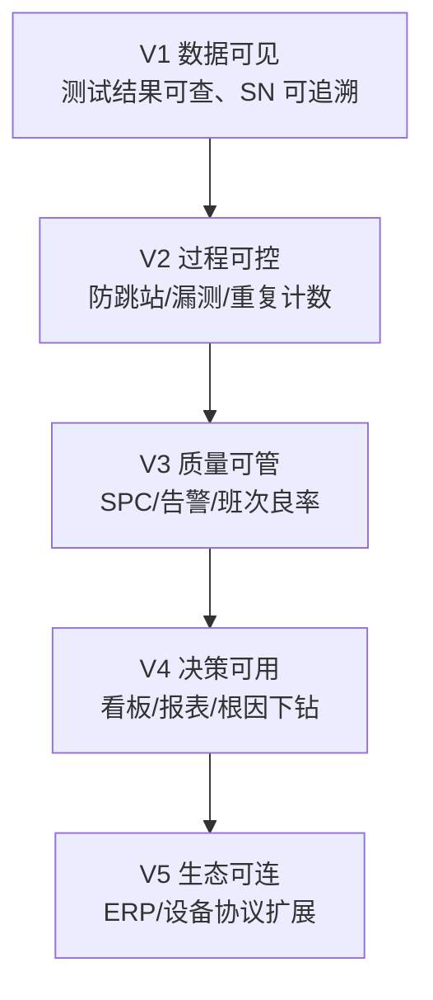

# 从 MIMS 到 MES：光通信制造的自动化测试与工厂数据信息化战略

> 文档类型：前沿技术 + 产品战略思考  
> 适用行业：光通信（光模块 / 光器件 / 光收发组件）及相近离散电子制造  
> 对齐材料：[MES调研.md](../MES调研.md)、[design.md](../design.md)、[AGENTS.md](../AGENTS.md)、[db design.md](./db%20design.md)  
> 版本：2026-07-30

---

## 1. 一句话定位

光通信工厂不缺「再做一个大而全 MES」，缺的是：**把测试站、上位机与 SN 事实链做成可约束、可追溯、可分析的制造能力平台**——先 MIMS 把数据做实，再演进为真正可执行的 MES。

```
MIMS（制造信息管理）          MES（制造执行）
记录事实 · 汇聚数据     →     约束流程 · 驱动执行 · 闭环质量
```

本仓库当前工程（工单 → 过站 → 测试上传 → 追溯）正是这条路径的 **MVP 锚点**：不是从排产/仓储切入，而是从 **测试 + 上位机 + 数据** 切入。

---

## 2. 为什么光通信必须先打「测试」这场仗

### 2.1 行业制造特征（决定产品形态）

| 特征 | 对信息化的含义 |
| --- | --- |
| 高混线、多型号、短迭代（400G/800G/1.6T 等代际） | 工艺与测试流程必须版本化，变更不能拖垮在制 SN |
| 测试工位占比高、节拍受仪器约束 | MES 的核心战场在测试站，而非纯装配报工 |
| 参数维度多（光功率、灵敏度、消光比、误码、温度循环等） | 需要结构化 Metrics + 原始报文双轨存储 |
| 客户/认证要求强追溯（SN → 工站 → 仪器 → 人员 → 批次） | TraceEvent 时间线是刚需，不是报表附属品 |
| 上位机异构、网络偶发抖动 | 幂等、离线缓存、批量补传比「炫酷看板」更优先 |
| 质量靠 SPC 与门限，而非仅靠人工经验 | 先采集事实，再做规则约束与班次级分析 |

### 2.2 光通信产线的真实痛点

1. **信息断层**：ERP 有订单，测试站有结果，中间靠 Excel / 共享盘 / 口头传递。  
2. **过程不可控**：跳站、漏测、Fail 未处置仍可流入下一站。  
3. **数据不可用**：有大量测试 log，却无法按 SN/工站/班次快速聚合与告警。  
4. **系统过重**：采购或自研「大而全 MES」实施周期长，测试闭环迟迟打不通。

结论：**先做成「测试执行 + 数据事实平台」（类 MIMS），再逐步加上流程门控与质量闭环（演进为 MES）。**

---

## 3. MIMS → MES：演进模型，而不是替换模型

### 3.1 概念边界（本战略采用的定义）

| 层级 | 名称 | 核心问题 | 典型能力 |
| --- | --- | --- | --- |
| L0 | 单机上位机 | 这台仪器测完了吗？ | 本地脚本、本地结果文件 |
| L1 | **MIMS** | 工厂数据能否统一汇聚、查询、统计？ | 测试结果库、SN 档案、基础报表 |
| L2 | **MES（执行）** | 能否按流程约束「能不能测 / 能不能过」？ | 工单、工站、工艺/测试流程、过站门控 |
| L3 | **MES（闭环）** | 能否用数据驱动质量与管理决策？ | SPC、告警、实时看板、返工/报废闭环 |
| L4 | 协同层（后置） | 能否与计划/仓储/企业主数据协同？ | ERP/APS/WMS 接口（第一阶段明确不做深度集成） |

### 3.2 演进原则（与现有设计一致）

1. **先记录、再约束、后分析**  
2. **先小后大**：单线体 / 单产品族闭环验证后再扩展  
3. **能力集合，而非巨型单体**：按 Test Flow / Station / Trace / SPC / Dashboard 增量交付  
4. **设备不稳定是常态**：本地缓存 + 服务端幂等 + 批量补传  

反模式：一上来做 APS、WMS、ERP 双向闭环——对光通信测试型工厂投入产出比极差。

### 3.3 与本仓库现状的映射

| 战略阶段 | 工程锚点 | 状态（截至文档日） |
| --- | --- | --- |
| MIMS 最小核 | `TestRecord` + `TraceEvent` + 追溯 API | ✅ 已具备（含 Metrics / RawPayload） |
| MES 执行核 | WorkOrder / Station / TestFlow / Pass 门控 | ✅ M1 闭环（流程顺序与工站授权） |
| MES 质量核 | SPC 规则、告警、班次汇总 | ⏳ M2 |
| MES 可视核 | 实时看板、SignalR、报表 | ⏳ M2–M3 |
| 持久化与事务 | PostgreSQL / EF Core、同事务一致性 | ⏳ 推进中 |
| 协同层 | ERP 主数据 / WMS | ❌ 第一阶段不做 |

---

## 4. 产品战略：做「制造能力平台」，不做「百科全书 MES」

### 4.1 产品主张

> **Optical Test-Centric MES**：以光通信测试执行链为中枢的制造能力平台。  
> 对操作员是「过站与门控」；对上位机是「可信上传契约」；对质量是「参数级追溯 + SPC」；对管理是「线体实时真相」。

### 4.2 价值阶梯（卖给工厂的叙事）



每一级都必须有可验收指标，避免「功能上了很多、现场不用」。

### 4.3 角色与产品面

| 角色 | 第一屏该解决的问题 | 产品形态建议 |
| --- | --- | --- |
| 操作员 | 扫 SN → 允许过站/测试？下一步去哪？ | 工站终端（现有 Blazor 工站模拟可演进） |
| 测试/上位机 | 上传是否成功、是否重复、失败如何重试 | 稳定 REST 契约 + 批量补传 |
| 工艺工程师 | 流程版本如何定义、激活、不影响在制 | Test Flow 版本治理 |
| 质量工程师 | 关键参数是否漂移、Fail 如何闭环 | SPC + 告警 + 追溯下钻 |
| 管理层 | 今日产出/良率/瓶颈站 | 实时看板（5 秒级可见） |

### 4.4 产品边界（第一阶段冻结）

**做：**

- 测试流程管理、工站控制、数据采集与追溯  
- 基础 SPC / 告警、基础报表与看板  
- 上位机 HTTP/REST 接入  

**不做：**

- APS 排产、WMS、ERP 深度双向业务  
- 一上来上 OPC-UA / TCP 全协议网关（第二阶段预留）  

---

## 5. 自动化测试战略（光通信场景）

自动化测试在这里有两层含义：**产线产品测试自动化**，以及 **MES 自身质量工程**。两者都要做，但优先级不同。

### 5.1 产线侧：把「测」变成可编排的制造能力

#### A. 测试流程即产品（Test Flow as Product）

- 流程绑定产品型号，支持版本与激活互斥（同产品仅一个 active）。  
- 步骤类型区分：过站（Pass）/ 测试（Test）。  
- 工单绑定流程版本，流程变更不影响已下发在制。  
- 未来扩展：并行站、可选站、返工回流（第二阶段）。

#### B. 站级门控（Station Gate）

最低门控集合（已与工程错误码对齐）：

| 门控 | 错误码 | 业务含义 |
| --- | --- | --- |
| 参数合法 | MES-4001 | 请求不完整 |
| 工序匹配 | MES-4002 | 跳站/漏站/未进站/Fail 未处置 |
| 工站授权 | MES-4003 | 站不存在或类型不符 |
| 流程可用 | MES-4004 | 产品无启用流程 |
| 幂等冲突 | MES-4091 | 重复上传/重复建单 |

光通信建议额外演进门控（产品 backlog）：

- **Fail Hold**：测试失败默认冻结，直至返工/报废/特采处置  
- **仪器能力匹配**：该站是否具备当前型号所需程序/夹具版本  
- **环境条件**：温循/老化站的时间窗与配方绑定  

#### C. 上位机契约（Device Contract）

首期坚持 HTTP/REST，契约原则：

1. **业务幂等键**：`(sn, station_code, test_batch_id)`  
2. **传输幂等键**：后续 `Idempotency-Key` Header  
3. **双轨载荷**：结构化 `Metrics` + `RawPayload`（原始报文不丢）  
4. **批量补传**：`/api/test-results/batch`，按发生时间重排入库  
5. **明确 Ack**：成功/可重试失败/不可重试失败（避免上位机盲重试）

#### D. 光通信典型测试链（产品模板示例）

```
组装过站 → 电性能初测 → 光性能测试 → 温循/老化
→ 终测（光+电） → 外观/包装过站 → Done
```

每个测试站沉淀统一指标字典（示例）：`TxPower`、`RxSensitivity`、`ER`、`BER`、`Temp`、`Current`……  
指标字典是 SPC 与跨型号对标的前提，应尽早治理，避免「每个上位机一个私有字段名」。

### 5.2 工程侧：用自动化保证 MES 自身可信

| 层级 | 建议 | 目的 |
| --- | --- | --- |
| 单元 | Domain 状态机、流程校验、SPC 规则 | 防回归 |
| 集成 | PostgreSQL + 唯一索引 + 事务边界（Testcontainers） | 防丢数/重复计数 |
| 契约 | 上位机上传 OpenAPI / 示例客户端 | 降低接入成本 |
| 性能烟测 | 单线体 ≥ 200 条/秒写入目标（design） | 守住节拍 |
| 现场演练 | 断网补传、重复上传、跳站拦截 | 验收真实场景 |

原则：**没有幂等与追溯测试的「测试系统」，本身不可信。**

---

## 6. 工厂数据信息化战略

### 6.1 数据分层（比「再加一张表」更重要）

```
主数据 Master     工站 / 产品 / 流程定义 / 用户角色
执行态 Runtime    工单状态 / SN 当前位置 / 待测步骤
事实层 Fact       TestRecord / TraceEvent / PassRecord（只增或准只增）
分析层 Analytics  SPC Snapshot / 班次汇总 / 看板缓存
原始层 Raw        RawPayload / 文件对象（冷热分层）
```

设计要点：

- **事实层不可被「改写历史」糊弄**——纠错通过补偿事件，而不是静默覆盖。  
- **分析层可重建**——汇总表坏了可以重算；事实层坏了不可接受。  
- **SN 是主键语言**——所有跨系统对话优先围绕 SN / 工单号。

### 6.2 数据可信三件套

1. **幂等**：重复上传不重复计数  
2. **事务**：写测试记录 + 改 SN 状态 + 写追溯事件同事务  
3. **审计**：手动放行、规则变更、流程激活必须留痕  

### 6.3 从「有数据」到「用数据」

| 阶段 | 问题 | 能力 |
| --- | --- | --- |
| 存得下 | log 爆炸、查询变慢 | 索引策略、冷热分层、对象存储存原始报文 |
| 查得快 | 客诉要 2 分钟内出 SN 时间线 | 追溯 API P95 ≤ 2s（MVP 目标） |
| 看得懂 | 班次良率、站别瓶颈 | SPC summary + 看板 |
| 管得住 | 参数漂移自动告警 | 规则引擎 + SignalR 推送 |
| 推得动 | 根因定位到仪器/夹具/批次 | 多维下钻（SN × 站 × 仪器 × 时间） |

### 6.4 与企业架构的位置（ISA-95 简化）

```
L4 ERP / PLM          订单、物料、BOM（后置对接）
        ↓
L3 MES（本产品）      执行、测试、追溯、SPC
        ↓
L2 上位机 / SCADA     测试程序、仪器控制
        ↓
L1 仪器 / 夹具 / PLC  物理执行
```

光通信工厂常见现状是 **L2 很强、L3 很弱**：上位机各自为政。战略重点是把 L2 的数据与门控「上收」为 L3 能力，而不是重写仪器控制软件。

---

## 7. 前沿技术地图：什么该用、什么该忍住

### 7.1 近 12–24 个月值得投入（与产品直接相关）

| 技术方向 | 在光通信 MES 中的用法 | 落地建议 |
| --- | --- | --- |
| **事件驱动架构** | 过站/测试上传 → 领域事件 → SPC/看板/告警 | RabbitMQ + 死信队列；先异步解耦，不要一上来微服务拆爆 |
| **实时推送** | 看板 5 秒可见、告警即时到岗 | SignalR（与现有 .NET 栈一致） |
| **边缘缓存与补传** | 站侧网络抖动 | 上位机本地队列 + 批量 API；服务端幂等兜底 |
| **指标字典 + 语义层** | 跨型号 SPC、跨工厂对标 | 先治理 Metrics 命名，再谈 AI |
| **规则化 SPC** | 越限告警、班次汇总 | M2 先做阈值/控制限，再做复杂 Western 规则 |
| **可观测性** | 上传失败、慢查询、队列堆积 | Serilog + OpenTelemetry |
| **AI 辅助质量（渐进）** | 参数漂移预警、相似 Fail 聚类、根因推荐 | 建立在干净事实层上；禁止无标签乱训 |

### 7.2 明确后置 / 克制的技术（避免炫技拖垮落地）

| 技术 | 为何后置 |
| --- | --- |
| 数字孪生全厂仿真 | 没有可信事实层，孪生是空壳 |
| 大而全工业互联网平台 | 实施复杂度高于测试闭环价值 |
| 过早微服务 / 多库分片 | MVP 单体分层 + 清晰边界足够 |
| 一上来 OPC-UA / 私有 TCP 全覆盖 | 先吃透 REST 契约与补传，再做 Device Gateway |
| 「大模型直接管产线」 | 安全与可解释性不足；先做辅助分析 |

### 7.3 推荐技术栈演进（与工程一致）

```
现在：.NET 8 + Minimal API + Blazor +（内存→PostgreSQL）
近程：EF Core · Redis · RabbitMQ · SignalR · Serilog/OTel
中程：Device Gateway · 指标语义层 · SPC 规则引擎增强
远程：ERP 适配 · OPC-UA/TCP · AI 质量助手
```

部署侧优先 **Windows Server + IIS / Windows Service**，贴合多数光通信工厂 IT 现状；云边协同可作为第二曲线，而非第一依赖。

---

## 8. 三年能力路线图（战略视图）

### 8.1 Horizon 1（0–3 个月）：执行闭环 —「测得进、查得到」

**目标**：单条产线稳定完成 过站 → 测试入库 → SN 追溯。

交付焦点：

- 工单 / 工站 / Test Flow / SN 过站 / 测试上传 / 追溯  
- 幂等与基础错误码体系  
- PostgreSQL 持久化与事务一致性  
- 上位机接入样例与补传策略  

验收：

- 重复上传不重复计数  
- 非法跳站被拦截  
- SN 时间线可一键拉通  

### 8.2 Horizon 2（3–9 个月）：约束 + 质量 —「管得住、告得响」

**目标**：流程版本治理 + 基础 SPC + 告警 + 实时看板。

交付焦点：

- 流程发布/审计、工单绑定版本  
- SPC 汇总、规则、告警事件  
- SignalR 看板  
- JWT + RBAC + 关键操作审计  

验收：

- 班次级良率与关键参数曲线可用  
- 越限自动告警并进入追溯链  
- 看板 5 秒内反映最新聚合  

### 8.3 Horizon 3（9–24 个月）：平台化 —「连得上、扩得开」

**目标**：从单线体能力平台走向多线体 / 多工厂可复制。

交付焦点：

- Device Gateway（OPC-UA / TCP / 厂商私有协议适配）  
- 指标语义层与跨型号分析  
- ERP 主数据同步（单向优先）  
- AI 辅助：Fail 聚类、漂移预警（人在回路）  
- 多租户/多工厂配置化（若有集团化需求）  

验收：

- 新线体接入以「配置 + 适配器」为主，而不是重写核心  
- 客诉追溯从小时级降到分钟级  
- 质量会议用系统数据，而不是手工表  

---

## 9. 竞争与差异化（产品视角）

### 9.1 常见选项为何不够

| 选项 | 典型问题 |
| --- | --- |
| 通用大 MES | 重排产/仓储，轻测试参数与上位机现实 |
| 纯测试数据库 / 自建 MIMS | 有数据无门控，跳站与 Fail 失控 |
| 仪器厂商封闭软件 | 单站很强，跨站追溯与工单协同弱 |
| 纯看板 BI | 没有执行事实，看板是「装饰」 |

### 9.2 本战略的差异化卡位

1. **Test-Centric**：以测试链为第一公民，而不是 ERP 报工的附属。  
2. **契约优先**：把上位机当成一等集成方，幂等/补传/原始报文从第一天设计。  
3. **演进式架构**：MIMS 能力自然长成 MES，避免推倒重来。  
4. **行业字典**：光通信指标与流程模板可沉淀为可复制资产。  

---

## 10. 组织与落地：比代码更难的部分

MES 成本结构提醒（来自调研共识）：**实施落地 > 软件开发**。

建议配套机制：

1. **单线体试点 Owner**：工艺 + 测试 + IT 各一名，周例会看闭环指标。  
2. **指标口径冻结**：良率、一次通过率、站别瓶颈定义先对齐管理口径。  
3. **变更治理**：流程激活、门限修改必须可审计、可回滚。  
4. **接入 SLA**：上位机团队按契约联调，禁止「私下改库写结果」。  
5. **拒绝范围漂移**：APS/WMS/ERP 深度集成进入正式变更流程后再做。  

---

## 11. 成功度量（North Star）

| 维度 | 指标 | MVP 目标感 |
| --- | --- | --- |
| 执行可信 | 重复上传导致的错误计数 | → 0 |
| 过程可控 | 非法跳站拦截率 / Fail 未处置流出率 | 可量化下降 |
| 追溯效率 | SN 全链路查询 P95 | ≤ 2s |
| 吞吐 | 测试结果写入 | ≥ 200 条/秒（单线体） |
| 质量可见 | 班次良率与关键参数曲线 | 每日自动产出 |
| 管理可用 | 看板数据与现场对账差异 | 持续收敛 |
| 产品健康 | 新站/新型号接入人天 | 逐季下降 |

北极星建议收敛为一句：

> **任意 SN，在 2 分钟内讲清：在哪测过、谁测的、结果是什么、为何现在能/不能流入下一站。**

---

## 12. 风险与对冲

| 风险 | 对冲 |
| --- | --- |
| 设备接入不稳定 | 统一契约 + 批量补传 + 幂等 + 死信 |
| 网络抖动丢数 | 站侧缓存 + 服务端去重 |
| 追溯数据膨胀变慢 | 索引、冷热分层、聚合快照 |
| 权限复杂拖垮进度 | RBAC 从最小角色集起步 |
| 做成大而全 | 里程碑冻结 + Out of Scope 清单 |
| AI/新技术概念绑架资源 | 事实层与 SPC 未稳前，AI 只做辅助 POC |

---

## 13. 战略结论与行动建议

### 13.1 结论

1. 光通信制造的数字化主战场是 **测试执行链与参数级事实数据**，不是先上排产。  
2. **MIMS → MES** 应是连续演进：先汇聚与追溯，再门控与 SPC，最后协同与智能。  
3. 产品应定位为 **Optical Test-Centric 制造能力平台**，用能力模块生长，而不是百科全书式一次交付。  
4. 技术上保持克制：事件驱动、实时推送、可观测性、规则 SPC 优先；数字孪生/大而全 IIoT/过早微服务后置。  
5. 本仓库已走在正确路径上——继续沿 M1 → M2 → M3 把「可信闭环」做硬，再谈平台扩张。

### 13.2 建议立刻坚持的三件事

1. **把上位机契约当产品**：文档化、示例化、版本化。  
2. **把幂等与追溯当底线**：任何功能都不能削弱 MES-4091 与 SN 时间线。  
3. **把单线体验收当战略**：没有现场闭环，不做下一层概念扩张。

### 13.3 与后续文档的关系

| 文档 | 职责 |
| --- | --- |
| 本文 | 为什么做、做成什么、边界与演进 |
| [design.md](../design.md) | 第一阶段怎么做（架构/API/里程碑） |
| [db design.md](./db%20design.md) | 数据如何落库 |
| [AGENTS.md](../AGENTS.md) | 工程实现约束（给研发与 AI 代理） |

---

## 附录 A：术语表

| 术语 | 含义 |
| --- | --- |
| MIMS | Manufacturing Information Management System，偏数据汇聚与信息管理 |
| MES | Manufacturing Execution System，偏车间执行、约束与闭环 |
| SN | 产品序列号实例（Serial Unit） |
| Test Flow | 产品绑定的有序测试/过站流程 |
| SPC | Statistical Process Control，统计过程控制 |
| 上位机 | 控制测试仪、执行测试程序并上传结果的工控软件 |
| 幂等 | 同一业务请求重复提交，只产生一次有效业务结果 |

## 附录 B：能力全景（第一阶段聚焦）

```
                    ┌─────────────────────────┐
                    │   Dashboard / Report    │  ← M3
                    └───────────▲─────────────┘
                                │
                    ┌───────────┴─────────────┐
                    │   SPC / Alarm Engine    │  ← M2
                    └───────────▲─────────────┘
                                │
     ┌──────────────┐   ┌───────┴────────┐   ┌──────────────┐
     │ Station Gate │──▶│  Execution Core │◀──│ Device Ingest│
     │ 过站/授权    │   │ 工单/SN/流程   │   │ REST/补传    │
     └──────────────┘   └───────▲────────┘   └──────────────┘
                                │
                    ┌───────────┴─────────────┐
                    │ Trace Fact Store        │  ← M1 核心
                    │ TestRecord + TraceEvent │
                    └─────────────────────────┘
```

— 完 —
