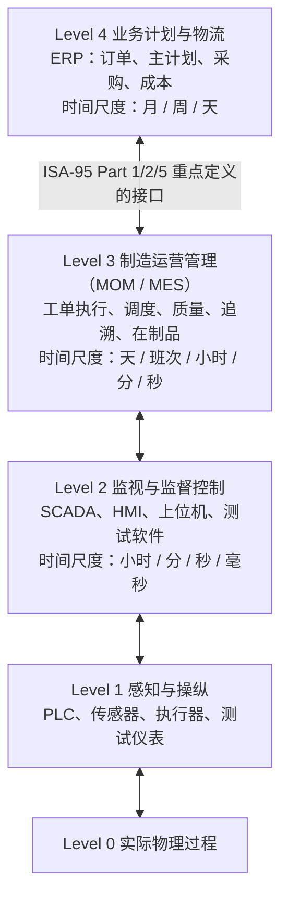
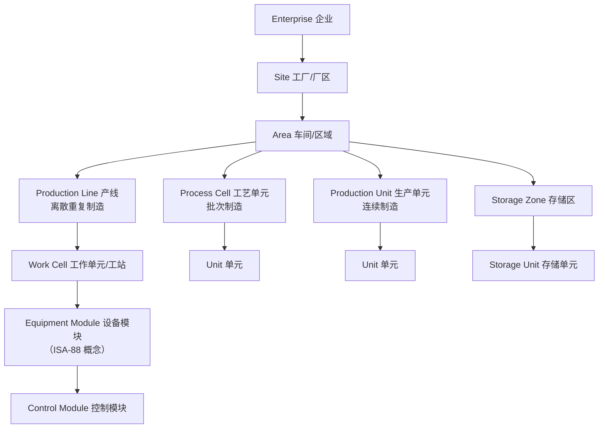
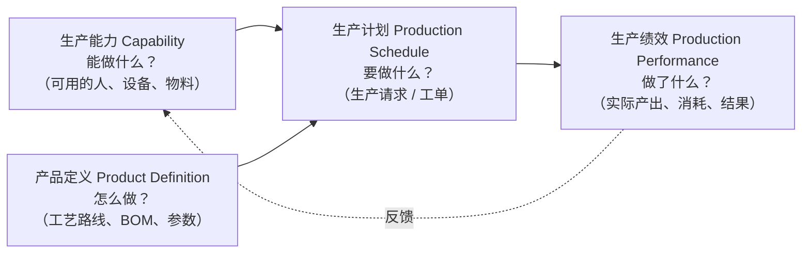
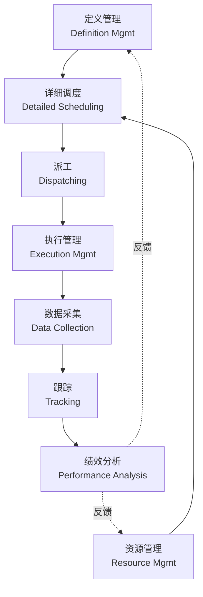

# ISA-95（IEC 62264）学习指南：用标准校准 MES 模型

> 目的：系统掌握 ISA-95 的核心模型，建立判断"一个 MES 模型设计得好不好"的标尺，并对照 MES-Thinking 当前实现找出差距与演进方向。
>
> 说明：本文为学习整理，非标准原文。标准正文需从 ISA / IEC 官方渠道获取；不同版本（2000 / 2010 / 2013 及之后修订）在术语上有细微差异，以所购版本为准。

---

## 1. ISA-95 是什么

| 项 | 说明 |
| --- | --- |
| 全称 | ANSI/ISA-95 Enterprise-Control System Integration（企业-控制系统集成） |
| 国际版 | IEC 62264（内容基本对应 ISA-95 各部分） |
| 解决的问题 | ERP（业务层）与车间控制层之间**边界在哪、交换什么信息、MES 内部有哪些活动** |
| 不解决的问题 | 不规定具体软件架构、数据库表结构、技术选型 |
| 常见实现 | B2MML（MESA 发布的 ISA-95 XML Schema 实现），可作为接口字段命名参考 |
| 相关标准 | ISA-88（批次控制，流程行业配方/设备模型）；ISA-95 的设备层级下层借用了 ISA-88 概念 |

**一句话理解**：ISA-95 是 MES 领域的"统一语言"。它告诉你应该有哪些概念、概念之间什么关系，但不告诉你怎么写代码。

### 1.1 标准组成（按学习优先级排序）

| 部分 | 主题 | 对 MES 开发的价值 | 优先级 |
| --- | --- | --- | --- |
| Part 1 | 模型与术语：功能层级、设备层级、功能数据流、对象模型概览 | 建立整体框架，划定 MES 边界 | ★★★ 必读 |
| Part 2 | 对象模型的属性（人员/设备/物料/工艺段/产品定义/生产计划/生产绩效等） | 直接指导领域建模 | ★★★ 必读 |
| Part 3 | 制造运营管理（MOM）活动模型 | 指导 MES 功能模块划分 | ★★★ 必读 |
| Part 4 | MOM 内部集成的对象与属性（工作定义、作业指令、作业响应等） | 指导 MES 内部模块间的数据模型 | ★★ 进阶 |
| Part 5 | 业务到制造的事务（Get / Process / Change / Sync 等动词） | 指导 ERP ↔ MES 接口设计 | ★★ 做 ERP 集成时读 |
| Part 6 及以后 | 消息服务模型、别名服务、信息交换配置等 | 大规模集成、多系统场景 | ★ 按需 |

---

## 2. 功能层级模型（Purdue / Level 0–4）：MES 的边界



### 2.1 要点

- **MES 位于 Level 3**。ISA-95 更推荐使用 **MOM（Manufacturing Operations Management）** 这个词，MES 是其中生产执行部分的通俗叫法。
- **Level 4 ↔ Level 3 接口**是 ISA-95 的核心关切：ERP 给 MES 下达"做什么"（生产计划、产品定义），MES 回报"做了什么"（生产绩效、物料消耗）。
- **Level 3 不做实时控制**。毫秒级逻辑留在 Level 1/2（PLC、上位机）；MES 负责规则约束、记录与协调。

### 2.2 对照本项目

| 本项目组件 | ISA-95 层级 |
| --- | --- |
| MES.Api / Application / Domain | Level 3 |
| 上位机、测试软件（通过 HTTP 上传测试结果） | Level 2 |
| 测试仪表、PLC | Level 1 |
| ERP（第一阶段不深度集成） | Level 4 |
| 计划中的 Device Gateway（OPC-UA / TCP） | Level 2 ↔ Level 3 适配层 |

**判断标尺**：如果一个 MES 在 Level 3 里写 PLC 实时控制逻辑，或者把 ERP 的成本核算、采购塞进来，就说明边界划错了。

---

## 3. 设备（角色）层级模型：工厂物理结构怎么建模



### 3.1 要点

- 层级按**角色**划分，不按物理设备划分：同一台设备可能在不同场景下扮演不同角色。
- 2010 版之后引入了通用术语 **Work Center**（Area 下的工作中心）和 **Work Unit**（Work Center 下的工作单元），用来统一离散、批次、连续三种制造类型。
- 光通信器件属于**离散/重复制造**，主路径是 `Enterprise → Site → Area → Production Line → Work Cell`。

### 3.2 对照本项目

当前的 `Station` 只有 `StationCode`、`Name`、`LineCode`、`IsTestStation`：

| ISA-95 概念 | 当前实现 | 差距 |
| --- | --- | --- |
| Site / Area | 无 | 多厂区、多车间时无法区分 |
| Production Line | `Station.LineCode` 字符串 | 线体不是实体，无法挂属性（班次、产能、负责人） |
| Work Cell | `Station` | 基本对应 |
| Equipment（测试仪表、治具） | 无 | 测试结果无法关联"用哪台仪表测的"，影响仪表校准追溯 |
| Equipment Class（设备类别） | `IsTestStation` 布尔值 | 一个布尔值无法表达"耦合站 / 老化站 / 光谱测试站"等多种能力 |

**判断标尺**：好的模型里，层级是树形实体结构，"工站能做什么"由 **设备类别 + 能力** 表达，而不是靠布尔开关或硬编码判断。

---

## 4. 四类资源 + 工艺段：MES 的"名词表"（Part 2 核心）

ISA-95 把所有生产活动涉及的东西归为 **四类资源** 加 **工艺段**：

```mermaid
flowchart LR
    subgraph Resources[资源]
        P[人员 Personnel]
        EQ[设备 Equipment]
        PA[物理资产 Physical Asset]
        M[物料 Material]
    end
    PS[工艺段 Process Segment<br/>"一个可复用的生产步骤<br/>需要哪些人员/设备/物料"]
    P --> PS
    EQ --> PS
    M --> PS
```

### 4.1 统一的"类别 - 实例 - 测试规格"三元模式

这是 ISA-95 最值得学习的建模套路，人员、设备、物料都遵循同一个结构：

| 资源 | 类别（Class） | 定义 / 实例 | 能力 / 质量测试 |
| --- | --- | --- | --- |
| 人员 | Personnel Class（如"测试操作员""工艺工程师"） | Person（张三，工号 1001） | Qualification Test Specification / Result（上岗资质、有效期） |
| 设备 | Equipment Class（如"光谱测试站""耦合台"） | Equipment（耦合台 #3） | Equipment Capability Test Specification / Result（能力验证、校准） |
| 物理资产 | Physical Asset Class | Physical Asset（具体固定资产编号的一台仪表） | 资产与设备角色的映射（换机后角色不变） |
| 物料 | Material Class（如"激光芯片""光纤跳线"） | Material Definition（物料号 P/N）→ Material Lot（批次）→ Material Sublot（子批 / 单件） | Material Test Specification（来料检验、过程检验规格） |

- **类别**承载共性属性和规则，例如"该类工站需要持证人员"。
- **实例**承载个体状态，例如"该人员资质 2026-12 到期"。
- **测试规格 / 结果**把"是否合格"建模为数据，而不是写死在代码里。

### 4.2 Equipment 与 Physical Asset 的区分

- **Equipment**：工艺角色，例如"3 号线光谱测试位"。
- **Physical Asset**：财务 / 维护视角的实物，例如"资产编号 FA-2024-0087 的光谱仪"。
- 仪表送校、更换时，角色不变、实物变化。追溯时需要同时知道**在哪个位置测的**和**用哪台实物测的**。光通信行业对仪表校准追溯要求高，这一点尤其重要。

### 4.3 SN 在 ISA-95 中的位置

ISA-95 没有专门的 "SN" 实体。**序列化的单件产品通常建模为 Material Lot / Sublot（数量为 1）**，并通过物料批次之间的**谱系（Genealogy）**关系表达"这个模块用了哪批芯片、哪根光纤"。

---

## 5. 四类信息模型：MES 的"动词表"（Part 2 核心）

这是 ISA-95 最核心的骨架。**每一类资源在四个阶段里都会出现一次**：



| 信息类别 | 核心对象 | 人员 / 设备 / 物料在此阶段的形态 |
| --- | --- | --- |
| 产品定义（How） | Product Definition → Product Segment（产品段）；BOM；制造清单 | Personnel / Equipment / Material **Specification**（规格：需要什么） |
| 生产能力（What can） | Production Capability → Process Segment Capability | Personnel / Equipment / Material **Capability**（可用 / 已承诺 / 不可用） |
| 生产计划（What to） | Production Schedule → Production Request → Segment Requirement | Personnel / Equipment / Material **Requirement**（本次需要多少） |
| 生产绩效（What was） | Production Performance → Production Response → Segment Response | Personnel / Equipment / Material **Actual**（实际用了谁、哪台、多少） |

### 5.1 关键区分：Process Segment 和 Product Segment

| | Process Segment（工艺段） | Product Segment（产品段） |
| --- | --- | --- |
| 视角 | 工厂能力视角：工厂会做什么工序 | 产品视角：这个产品需要哪些工序 |
| 与产品的关系 | 与具体产品无关，可复用 | 绑定具体产品与版本 |
| 例子 | "光谱测试"（需 1 名持证操作员 + 1 台光谱仪） | "产品 A v2 的第 3 步：光谱测试，波长 1550±1nm" |
| 关系 | 产品段**引用**工艺段 | |

**判断标尺**：如果一个 MES 只有"产品路线"、没有"工序库"，每个新产品就都要从头定义工序。工艺变更时无法批量识别受影响的产品。

### 5.2 Specification → Requirement → Actual 的价值

同一个维度（比如"需要什么设备"）在定义、计划、执行三个阶段分别记录，于是可以自动对比：

- **定义 vs 实际**：工艺要求用 A 类仪表，实际用了 B 类，判定为违规。
- **计划 vs 实际**：计划 100 件，产出 96 件，良率和差异分析就有了数据。

这正是 SPC、良率分析和追溯的数据来源。

---

## 6. MOM 活动模型：MES 应该有哪些功能（Part 3 核心）

### 6.1 四大运营领域

| 领域 | 说明 | 本项目阶段 |
| --- | --- | --- |
| 生产运营管理（Production Operations） | 工单、调度、派工、执行、过站 | 第一阶段核心 |
| 质量运营管理（Quality Operations） | 检验 / 测试、质量判定、SPC、不良处置 | 第一阶段核心（测试 + SPC） |
| 库存运营管理（Inventory Operations） | 车间内物料移动、线边库存 | 不做（WMS 范畴，可预留） |
| 维护运营管理（Maintenance Operations） | 设备维护、校准、点检 | 后续（仪表校准可优先考虑） |

### 6.2 每个领域都包含的 8 个通用活动



| 活动 | 含义 | 本项目对应 | 状态 |
| --- | --- | --- | --- |
| 定义管理 | 管理产品定义、工艺路线、版本 | `TestFlow` / `RouteStep` 创建、激活 | ✅ 基础 |
| 资源管理 | 管理人员、设备、物料的可用性与能力 | `Station` 主数据 | ⚠️ 仅工站，无人员 / 设备 / 物料 |
| 详细调度 | 把工单排到具体时段、设备 | 无 | ❌ 第一阶段不做（与 APS 边界相关） |
| 派工 | 把工单下发到产线 / 工站，控制开工 | 工单 release/start（设计中） | ⏳ |
| 执行管理 | 确保按定义执行：工序校验、防错 | `PassStation` 工序顺序与工站授权校验 | ✅ |
| 数据采集 | 采集过程数据、测试数据 | `UploadTestResult`，含 `Metrics`、`RawPayload` | ✅ |
| 跟踪 | 记录在制品位置、谱系、事件 | `SerialUnit` 状态、`TraceEvent` | ✅ 基础，缺物料谱系 |
| 绩效分析 | 良率、OEE、SPC、KPI | `SpcService`、看板 | ✅ 基础 |

**判断标尺**：拿到任何 MES，用这 8 个活动 × 4 个领域做矩阵，逐格打勾，就能快速看清它的功能覆盖和短板。

---

## 7. Part 4 补充：MES 内部的工作模型

Part 4 把 Part 2 的思想下沉到 MES 内部，常用对象如下：

| 对象 | 含义 | 与 Part 2 的关系 |
| --- | --- | --- |
| Work Master | 工作主定义：可执行的工作模板（工艺段在 MES 内的细化） | 对应 Product / Process Segment |
| Work Directive | 工作指令：某次执行用的 Work Master 快照 | 下达时冻结版本，执行中不受后续修改影响 |
| Work Request / Job Order | 工作请求 / 作业单：要执行的具体任务 | 对应 Production Request / Segment Requirement |
| Job Response / Work Response | 作业响应：执行结果 | 对应 Production / Segment Response |

**Work Directive 的"版本快照"思想对本项目很关键**：工单绑定的应该是**下达时的流程版本快照**。否则执行中有人修改或重新激活流程，在制品的校验规则就会被悄悄改变。

---

## 8. Part 5 补充：ERP ↔ MES 接口的设计套路

Part 5 用"动词 + 名词"的方式定义事务，例如：

| 动词 | 含义 | 例子 |
| --- | --- | --- |
| Get / Show | 查询与应答 | ERP 查询工单进度 |
| Process / Acknowledge | 请求处理与确认 | ERP 下发工单，MES 确认接收 |
| Change / Respond | 变更与应答 | ERP 修改计划数量 |
| Cancel | 取消 | ERP 取消工单 |
| Sync | 同步（发布 / 订阅） | 物料主数据同步、生产绩效回报 |

名词是第 5 节的对象：ProductionSchedule、ProductionPerformance、MaterialDefinition 等。

**对本项目的意义**：第一阶段只预留接口，但字段命名和接口语义可以先参考 B2MML，将来对接 ERP 时就能减少字段映射的争议。

---

## 9. 用 ISA-95 评审 MES 模型：检查清单

拿到任何 MES 项目（包括自己的），按以下问题逐条检查：

### 9.1 边界
- [ ] 是否把实时控制、毫秒级逻辑留在 Level 1/2？
- [ ] 是否把成本核算、采购、主计划留在 Level 4？
- [ ] 与 ERP 的接口是否明确区分了"计划下达"和"绩效回报"两个方向？

### 9.2 资源模型
- [ ] 人员、设备、物料是否都有"类别 - 实例"两层？
- [ ] 工站能力是否由设备类别 / 能力表达，而不是布尔开关？
- [ ] 人员资质是否建模，并能在执行时校验（无证不能上岗）？
- [ ] 设备与物理资产是否区分（仪表更换后追溯不断链）？

### 9.3 定义与执行
- [ ] 是否区分工艺段（工厂能力）与产品段（产品工艺）？
- [ ] 工艺路线是否有版本，工单是否绑定下达时的版本快照？
- [ ] 测试判定标准（规格上下限）是否是数据，而不是代码里的常量？
- [ ] 是否能对比 Specification / Requirement / Actual 三者的差异？

### 9.4 跟踪与追溯
- [ ] 能否从 SN 追到：工单、每一步的工站、设备实物、人员、时间、测试结果、所用规格版本？
- [ ] 能否追到物料谱系：用了哪批原材料（正向追溯和反向追溯）？
- [ ] 不良处置（返工、报废、让步放行）是否作为事件被记录？

### 9.5 绩效
- [ ] 良率、一次通过率是否基于"实际"数据自动计算？
- [ ] 计划与实际的差异是否可查询？

---

## 10. MES-Thinking 现状对照与演进建议

### 10.1 实体映射

| 本项目实体 | ISA-95 对应 | 符合度 | 主要差距 |
| --- | --- | --- | --- |
| `WorkOrder`（工单号、产品、数量、状态、流程编码） | Production Request / Job Order | 较好 | 缺计划起止时间；绑定的是流程编码，不是版本快照 |
| `TestFlow` + `RouteStep` | Product Definition + Product Segment | 较好 | 缺可复用的工艺段库；步骤里缺资源规格（人员资质、设备类别、物料）和测试规格上下限 |
| `Station` | Work Cell / Work Unit | 基础 | 缺 Site / Area / Line 层级；`IsTestStation` 应演进为设备类别 |
| `SerialUnit` | Material Sublot（序列化单件） | 基础 | 缺物料谱系（组件绑定）；缺产品定义版本引用 |
| `TestRecord` | Quality Test Result / Segment Response 的一部分 | 基础 | 缺工单号、操作员、仪表实物编号、测试程序版本、所用规格版本 |
| `TraceEvent` | Tracking 事件 / Production Response | 基础 | `OperatorId` 是字符串，没有人员模型；缺设备实物维度 |
| `SpcRule` / `AlarmEvent` | Quality Performance Analysis | 基础 | 规则绑定的是产品 + 工站 + 指标，应能关联到测试规格 |
| 无 | Personnel / Personnel Class / Qualification | 缺失 | 无法做"无证不能上岗"校验 |
| 无 | Equipment / Physical Asset / Capability Test | 缺失 | 无法做"仪表过期不能测试"校验 |
| 无 | Material Definition / Lot / BOM | 缺失 | 无法做物料追溯（客户投诉时最常问"这批芯片还用在哪些产品上"） |

### 10.2 演进建议（与现有里程碑对齐，保持"先小后大"）

**原则**：不要一次性照搬 ISA-95 的全部对象。**先对齐概念和命名，按需增量建模。**

| 优先级 | 建议 | 理由 | 建议阶段 |
| --- | --- | --- | --- |
| P0 | 工单绑定**流程版本快照**（Work Directive 思想） | 防止执行中改流程导致在制品的校验规则被悄悄改变，属于数据正确性问题 | 当前 |
| P0 | `TestRecord` 补充工单号、操作员、仪表编号、测试程序版本 | 字段成本低，追溯价值高，事后无法补录 | 当前 |
| P1 | 引入**测试规格**（指标、上下限、单位、版本），挂在 `RouteStep` 上 | 判定标准数据化；SPC 规则可以引用规格 | M2 |
| P1 | 建立 Site → Area → Line → Station 层级，`IsTestStation` 演进为设备类别 | 为多线体扩展做准备 | M2 |
| P1 | 人员模型 + 资质校验（最小版：人员、角色、资质、有效期） | 与 JWT/RBAC 一起做，审计也需要人员实体 | M2–M3 |
| P2 | 设备实物 + 校准有效期校验 | 光通信行业仪表校准追溯是刚需 | M3 / 第二阶段 |
| P2 | 物料批次 + 组件绑定（谱系） | 支持正向和反向追溯 | 第二阶段 |
| P3 | 可复用工艺段库（Process Segment） | 产品种类增多后再做 | 第二阶段 |
| P3 | ERP 接口参考 Part 5 / B2MML 命名 | 现在只需预留接口 | 第二阶段 |

---

## 11. 推荐学习路径

| 步骤 | 内容 | 产出 |
| --- | --- | --- |
| 1 | 通读 Part 1：层级模型、功能数据流 | 能画出本工厂的 Level 0–4 图，并标出 MES 边界 |
| 2 | 精读 Part 2 的资源模型与四类信息模型 | 能把本项目实体逐一映射到 ISA-95 对象（即第 10.1 节） |
| 3 | 精读 Part 3 活动模型 | 完成"8 活动 × 4 领域"覆盖矩阵（即第 6.2 节） |
| 4 | 浏览 B2MML Schema | 熟悉标准字段命名，用于接口和表结构命名参考 |
| 5 | 阅读 Part 4 | 理解 Work Master / Directive，落实版本快照 |
| 6 | 做 ERP 集成前阅读 Part 5 | 设计 ERP ↔ MES 事务接口 |

### 11.1 资料获取渠道

- ISA 官方：ANSI/ISA-95 系列标准（付费）
- IEC 官方：IEC 62264 系列（付费）
- 国家标准：GB/T 20720（等同采用 IEC 62264，可通过国家标准全文公开系统等渠道查阅）
- MESA International：B2MML Schema 及相关白皮书
- 辅助阅读：Bianca Scholten《The Road to Integration: A Guide to Applying the ISA-95 Standard in Manufacturing》（ISA 出版，偏实践）

---

## 12. 术语中英对照

| 英文 | 中文 | 备注 |
| --- | --- | --- |
| Manufacturing Operations Management (MOM) | 制造运营管理 | ISA-95 对 MES 范畴的正式称呼 |
| Enterprise / Site / Area | 企业 / 工厂 / 区域（车间） | 设备层级 |
| Work Center / Work Unit | 工作中心 / 工作单元 | 2010 版之后的通用术语 |
| Production Line / Work Cell | 产线 / 工作单元（工站） | 离散制造 |
| Personnel Class / Person | 人员类别 / 人员 | |
| Equipment Class / Equipment | 设备类别 / 设备 | |
| Physical Asset | 物理资产 | 实物，带资产编号 |
| Material Class / Definition / Lot / Sublot | 物料类别 / 物料定义 / 批次 / 子批 | 序列化单件可建模为 Sublot |
| Process Segment | 工艺段 | 工厂视角，可复用 |
| Product Definition / Product Segment | 产品定义 / 产品段 | 产品视角，有版本 |
| Production Capability | 生产能力 | |
| Production Schedule / Request | 生产计划 / 生产请求 | 约等于工单 |
| Production Performance / Response | 生产绩效 / 生产响应 | 实际执行结果 |
| Segment Requirement / Response | 段需求 / 段响应 | 计划与实际在步骤级的体现 |
| Specification / Requirement / Actual | 规格 / 需求 / 实际 | 定义、计划、执行三阶段 |
| Work Master / Work Directive | 工作主定义 / 工作指令 | Part 4；指令是版本快照 |
| Job Order / Job Response | 作业单 / 作业响应 | Part 4 |
| Genealogy | 谱系 | 物料批次之间的组成关系 |
| B2MML | Business To Manufacturing Markup Language | ISA-95 的 XML 实现 |
